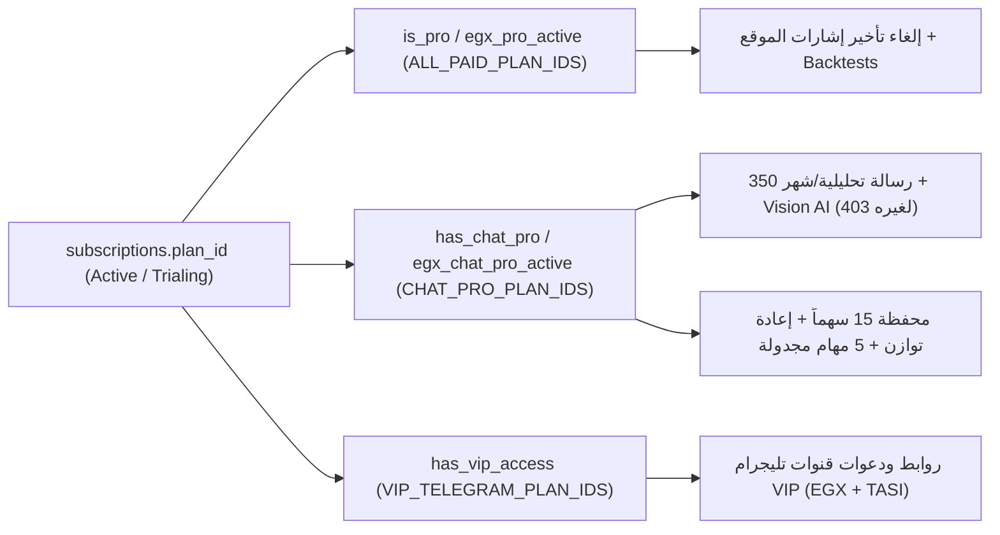

# معمارية الباقات والتسعير وعزل الصلاحيات (Pricing, Entitlements, Founders & Compliance Architecture)

**إصدار الوثيقة:** 1.0.0  
**تاريخ الإنشاء:** 19 نوفمبر 2026  
**الحالة:** معتمد ومطبّق (تهجير قاعدة البيانات مطبّق Live على مشروع Supabase `gfcmaxbtscmizsakarvc`، وتعديلات الكود والوثائق جاهزة محلياً بانتظار موافقة النشر).  
**الوثائق ذات الصلة:** [SYSTEM_ARCHITECTURE_AND_CDN_EDGE.md](SYSTEM_ARCHITECTURE_AND_CDN_EDGE.md) • [VERCEL_ZERO_CPU_ARCHITECTURE.md](VERCEL_ZERO_CPU_ARCHITECTURE.md) • [docs/fra-submission-dossier/](fra-submission-dossier/)

---

## 1. جدول الباقات والتسعير (مصر EGX والسعودية/الخليج `tasi`)

يعتمد التسعير على فصل الاشتراك إلى مسارين مستقلين (`chat_only` و`vip_only`) بجانب الباقة الشاملة (`pro`) بوصفها الخيار الأفضل قيمةً (Hero Plan)، مع الحفاظ على باقة مدى الحياة (`lifetime`) وتفعيل **سلايدر المدة التصاعدي (1–12 شهراً)** لجميع الباقات الفردية والشاملة:

| الباقة | `plan_id` | السعر المصري | السعر السعودي (`SA`) | فاتورة EasyKash لحسابات `tasi` | المدة | ملخص المزايا |
|---|---|---:|---:|---:|---|---|
| **المجانية** | `free` | `0 ج.م` | `0 ر.س` | — | مفتوحة | `10` رسائل شات مدى الحياة + رصيد المكافآت (`bonus_credits`)، محفظة حتى `5` أسهم، إشارات موقع متأخرة، بدون Vision AI أو أتمتة أو VIP |
| **الشات الذكي** | `chat_only` | **`100 ج.م/شهر`** (حتى `900 ج.م`/سنة) | **`10 ر.س`** | `128 ج.م` | `30..365` يوماً | `350` رسالة تحليلية شهرياً، Vision AI (شارت/محافظ)، محفظة `15` سهماً، `5` مهام مجدولة يومياً، إعادة توازن المحفظة، وإلغاء تأخير الموقع (`signal_delay_days = 0`) — **بدون** قناة VIP |
| **تليجرام VIP** | `vip_only` | **`100 ج.م/شهر`** (حتى `900 ج.م`/سنة) | **`10 ر.س`** | `128 ج.م` | `30..365` يوماً | دعوة قنوات تليجرام VIP (EGX + TASI) وإلغاء تأخير إشارات الموقع (`signal_delay_days = 0`) — **معزول** على حدود المجاني في الشات (`10` رسائل + المكافآت)، `5` أسهم بالمحفظة، بدون Vision AI أو أتمتة |
| **الباقة الشاملة (Hero)** | `pro` | **`150 ج.م/شهر`** | **`15 ر.س`** | `191 ج.م` | `30..365` يوماً | **الشات الذكي Pro + قنوات تليجرام VIP معاً** (كافة الصلاحيات) |
| **الباقة الشاملة (6 شهور)** | `pro_6m` / `pro` (`6m`) | **`750 ج.م`** | **`75 ر.س`** | `956 ج.م` | `180` يوماً | كافة مزايا الباقة الشاملة بخصم نصف سنوي (`17%` — ادفع 5 واحصل على 6) |
| **الباقة الشاملة (سنوي)** | `pro_1y` / `pro` (`12m`) | **`1,350 ج.م`** | **`135 ر.س`** | `1,721 ج.م` | `365` يوماً | كافة مزايا الباقة الشاملة بخصم سنوي (`25%` — ادفع 9 واحصل على 12) |
| **مدى الحياة** | `lifetime` | **`2,250 ج.م`** | **`225 ر.س`** | `2,869 ج.م` | مدى الحياة | كافة مزايا الباقة الشاملة (`chat_pro` + `vip_access`) دون تجديد |

### جدول خصم المدة التصاعدي (1–12 شهراً للباقات الفردية والشاملة)
تُحسب أسعار جميع المدد من مضاعف عشري دقيق (`DURATION_SLIDER_SCHEDULE` في `api/payment_common.py` و`DURATION_SLIDER_SCHEDULE` في `web/src/lib/duration-pricing.ts`) مع تقريب `ROUND_HALF_UP` في التحويل للريال السعودي (`_saudi_sar_amount`):

| الشهور | الأيام | المضاعف المحاسبي | الخصم | مؤسس 50 (`50/ش`) | `chat_only` / `vip_only` / مؤسس 100 (`100/ش`) | `pro` الشاملة (`150/ش`) |
|---:|---:|---:|---:|---:|---:|---:|
| `1` | `30` | `1.0` | `0%` | `50 ج.م` | `100 ج.م` | `150 ج.م` |
| `2` | `60` | `1.9` | `5%` | `95 ج.م` | `190 ج.م` | `285 ج.م` |
| `3` | `90` | `2.7` | `10%` | `135 ج.م` | `270 ج.م` | `405 ج.م` |
| `4` | `120` | `3.5` | `13%` | `175 ج.م` | `350 ج.م` | `525 ج.م` |
| `5` | `150` | `4.3` | `14%` | `215 ج.م` | `430 ج.م` | `645 ج.م` |
| `6` | `180` | `5.0` | `17%` | `250 ج.م` | `500 ج.م` | `750 ج.م` |
| `7` | `210` | `5.7` | `19%` | `285 ج.م` | `570 ج.م` | `855 ج.م` |
| `8` | `240` | `6.4` | `20%` | `320 ج.م` | `640 ج.م` | `960 ج.م` |
| `9` | `270` | `7.1` | `21%` | `355 ج.م` | `710 ج.م` | `1,065 ج.م` |
| `10` | `300` | `7.8` | `22%` | `390 ج.م` | `780 ج.م` | `1,170 ج.م` |
| `11` | `330` | `8.4` | `24%` | `420 ج.م` | `840 ج.م` | `1,260 ج.م` |
| `12` | `365` | `9.0` | `25%` | `450 ج.م` | `900 ج.م` | `1,350 ج.م` |

### قاعدة عرض الباقات لسوقَي الإمارات (`uae`) وقطر (`qatar` / `isGccChatOnly`)
- نظراً لعدم وجود قنوات تليجرام VIP خاصة بأسهم الإمارات أو قطر حالياً، تُعرض باقة `chat_only` (**`10 د.إ / ر.ق` — `AI Pro`**) كـ **الباقة الرئيسية الموصى بها (Hero Card)** في أسواق `isGccChatOnly` (لمن يستخدم شات الذكاء الاصطناعي لكل الأسواق والذهب والفضة + `Vision AI` + المحفظة).
- وتُعرض باقة `pro` (**`15 د.إ / ر.ق` — `باقة كل الأسواق الشاملة (+ تليجرام VIP)`**) بوضوح تام كترقية شاملة تفتح بالإضافة للشات **قنوات تليجرام VIP للسوق السعودي (`TASI`) والمصري (`EGX`) + رادار السيولة + `5` أتمتات يومية**.

---

## 2. قواعد حماية المؤسسين (Founders 50 & 100 EGP)

تطبق حماية الأسعار التأسيسية حصرياً على **الباقة الشاملة** (`pro` مع أي مدة `1..12` شهراً عبر السلايدر):

- **مؤسس 50 ج.م:** يحتفظ بسعر **`50 ج.م/شهر`**، وبنفس جدول الخصم التصاعدي على الباقة الشاملة (**`250 ج.م/6 شهور`** و**`450 ج.م/سنة`**؛ وفي وضع السوق السعودي `5 ر.س/شهر`، `25 ر.س/6 شهور`، `45 ر.س/سنة`).
- **مؤسس 100 ج.م:** يحتفظ بسعر **`100 ج.م/شهر`**، وبنفس جدول الخصم التصاعدي على الباقة الشاملة (**`500 ج.م/6 شهور`** و**`900 ج.م/سنة`**؛ وفي وضع السوق السعودي `10 ر.س/شهر`، `50 ر.س/6 شهور`، `90 ر.س/سنة`).
- **قاعدة العزل وعدم منح صفة المؤسس:**
  - باقتا `chat_only` و`vip_only` تظلان ثابتتين عند `100 ج.م/شهر` (`10 ر.س`) قبل تطبيق خصم السلايدر التصاعدي (`100..900 ج.م`) ولا تمنحان صفة المؤسس أو أولوية التسجيل ضمن أوائل الـ 100.
  - يُحتسب المؤسسون في الاستعلامات من `plan_id IN ('pro', 'lifetime', 'pro_lifetime')` فقط.
- **تجربة المستخدم في صفحة التسعير:** تعرض `web/src/app/pricing/PricingClient.tsx` بانراً مخصصاً للمشترك المؤسس يبرز له **الباقة الشاملة** بسعره المحفوظ مدى الحياة (`50` أو `100 ج.م`) مرتبطاً مباشرةً بسلايدر المدة (1–12 شهراً).

---

## 3. معمارية عزل الصلاحيات (Capability Isolation Architecture)

لا يُسمح أبداً بالاعتماد على علم واحد عام لفتح كل المزايا. يتم تفكيك `subscriptions.plan_id` عبر مصدر الحقيقة المشترك إلى ثلاثة أعلام متمايزة:



### مصفوفة عزل المزايا (Entitlements Matrix)

| الميزة / الصلاحية | `free` | `vip_only` | `chat_only` | `pro` / `pro_6m` / `pro_1y` / `lifetime` | العلم الحاكم |
|---|---|---|---|---|---|
| تأخير إشارات الموقع (`signal_delay_days`) | متأخرة | **`0` (فورية)** | **`0` (فورية)** | **`0` (فورية)** | `is_pro` / `ALL_PAID_PLAN_IDS` |
| سجل الفحوصات والـ Backtests المدفوعة | محدودة | مفعّلة | مفعّلة | مفعّلة | `hasActiveProSubscription` |
| رصيد رسائل AI Chat | `10` مدى الحياة (+ مكافآت) | `10` مدى الحياة (+ مكافآت) | **`350` / شهر** | **`350` / شهر** | `has_chat_pro` (`CHAT_PRO_PLAN_IDS`) |
| رفع صور الشارت والمحفظة (Vision AI) | مرفوض (`403 PRO_REQUIRED`) | مرفوض (`403 PRO_REQUIRED`) | **مفعّل** | **مفعّل** | `has_chat_pro` + `egx_chat_pro_active` |
| حد أسهم المحفظة (`record_portfolio_transaction`) | `5` أسهم | `5` أسهم | **`15` سهماً** | **`15` سهماً** | `has_chat_pro` + RPC SQL |
| إعادة توازن المحفظة (`portfolio/rebalance`) | حصة المجاني (`10` مدى الحياة) | حصة المجاني (`10` مدى الحياة) | **حصة `350`/شهر** | **حصة `350`/شهر** | `has_chat_pro` |
| المهام المجدولة (Scheduled Automations) | غير متاحة (`0`) | غير متاحة (`0`) | **`5` مهام يومياً** | **`5` مهام يومياً** | `has_chat_pro` |
| قنوات تليجرام VIP والدعوات التلقائية | غير متاحة | **مفعّلة** | **غير متاحة** | **مفعّلة** | `has_vip_access` (`VIP_TELEGRAM_PLAN_IDS`) |

---

## 4. خريطة الملفات المرجعية (Single-Source Implementation Map)

### أ) قاعدة البيانات والتهجير (`supabase/migrations/`)
- `supabase/migrations/20261119024500_split_chat_and_vip_plans.sql`:
  - إضافة صفوف `chat_only` و`vip_only` (`10000` قرش) وتحديث `pro` إلى `15000` قرش.
  - تحديث `local_billing_settings` (`pro_price_egp=150`, `founders_regular_price_egp=150`, `pro_6m_price_egp=750`, `pro_1y_price_egp=1350`).
  - تحديث `activate_easykash_subscription` لدعم التبديل/الترقية مع قيد `UNIQUE(user_id)` وقبول `chat_only` و`vip_only`.
- `supabase/migrations/20261119031500_fix_founders_trigger_and_portfolio_split.sql`:
  - تحديث دالة `public.check_founders_checkout_amount()` لتجاوز التحقق المحلي بالجنيه المصري عندما يكون `COALESCE(new.customer_note, '') ILIKE 'Market: tasi%'` (السعودية/الخليج)، والسماح بمبالغ `(50, 100, 150, 200)` ج.م بجانب `v_expected`.
  - تحديث دالة `public.record_portfolio_transaction(...)` لمنح `max_stocks := 15` لباقات `('pro','pro_6m','pro_1y','lifetime','pro_lifetime','chat_only')` وإبقاء `'vip_only'` على `5` أسهم.
- `supabase/migrations/20261119042000_multi_month_duration_slider.sql`:
  - إضافة عمود `local_payment_orders.duration_days integer` لتخزين مدة الاشتراك بالأيام (`30..365`) وتمريرها عند التفعيل.
  - توسيع `activate_easykash_subscription` لقبول المدد من شهر حتى 12 شهراً (`30, 60, ..., 330, 365, 36500`).
  - تحديث `check_founders_checkout_amount()` بشرط `AND COALESCE(new.duration_days, 30) = 30` كي لا تُرفض فواتير الباقات متعددة الشهور.
- `supabase/migrations/20261119045000_gcc_markets_founders_trigger.sql`:
  - تحديث `check_founders_checkout_amount()` لإعفاء فواتير الإمارات (`Market: uae%`) وقطر (`Market: qatar%`) بجانب السعودية (`Market: tasi%`) من فحص سقف الـ 1 شهر بالجنيه المصري.
- `supabase/migrations/20261119131500_subscription_upgrade_safety.sql`:
  - تحصين `activate_easykash_subscription()` ضد مسح/تخفيض الاشتراكات النشطة: منع استبدال `lifetime`، منع تخفيض `pro` النشط، الترقية التلقائية إلى `pro` عند تداخل باقتين فرديتين، وحفظ الأيام المتبقية عند الترقية من `chat_only`/`vip_only` إلى `pro`.

### ب) خادم بايثون الخلفي (`api/` — يعمل على Hugging Face FastAPI)
- `api/perf_utils.py`: تعريف `FULL_PRO_PLAN_IDS`, `CHAT_PRO_PLAN_IDS`, `VIP_TELEGRAM_PLAN_IDS`, `ALL_PAID_PLAN_IDS` ودوال `has_active_chat_pro`, `has_active_vip_telegram`, `_get_user_plan_flags`, `resolve_verified_viewer`, `resolve_subscription_quota_window`.
- `api/plan_limits.py`: حدود الباقات (`chat_only_limits`, `vip_only_limits`, `plan_limits`) ودالتا `has_chat_pro_user` و`has_vip_telegram_user`.
- `api/payment_common.py`: جدول `DURATION_SLIDER_SCHEDULE` (`1..12` شهراً)، دوال `normalize_duration_months` و`duration_days_for_months` و`duration_pricing_schedule`، ودعم `duration_months` في `plan_amount_egp` مع حفظ أسعار المؤسسين `50`/`100` على الباقة الشاملة، وصياغة العروض المتوافقة مع FRA.
- `api/easykash_payments.py`: خريطة الباقات `_PLANS`، التحويل السعودي `_SAUDI_SAR_EXCHANGE_MAP` وتقريب `ROUND_HALF_UP` في `_saudi_sar_amount`، دعم `duration_months` وحفظ `duration_days` في `create_checkout`/`process_callback`/`sync_easykash_order_status`/`order_status`، واستثناء `chat_only` من `ensure_pro_invite` عبر `_VIP_ELIGIBLE_PLAN_IDS`.
- `api/routers/easykash.py` و`api/routers/offload_user.py`: قبول وتمرير `duration_months` (`1..12`) في `/create` واسترجاع `duration_days` في `/status`.
- `api/telegram_pro_invites.py`: تضمين `vip_only` واستبعاد `chat_only` من `ACTIVE_PRO_PLAN_IDS`، وتخصيص رسالة الترحيب (`include_vip_invite`).
- `api/telegram_vip_chat.py` و`api/native_telegram_vip_chat.py` و`api/telegram_bot.py`: فصل صلاحيات `/start` وبوت الشات عن قناة VIP، مع الحفاظ على حد `<= 199` حرفاً لتنبيهات `answerCallbackQuery`.
- `api/agentic_chat/router.py` و`auth_guard.py` و`prompts.py` و`tools_execution.py`: اشتراط `has_chat_pro_user` في الشات والأتمتة ورفض مرفقات Vision AI بـ `403 PRO_REQUIRED` لغير مشتركي الشات، والالتزام الصارم بصياغة FRA وبوابة EasyKash في الـ System Prompt.
- `api/scheduled_automations_worker.py`: حصر `_is_user_pro` في `{"pro", "pro_6m", "pro_1y", "lifetime", "pro_lifetime", "chat_only"}` (رفض `vip_only`).
- `api/routers/offload.py` و`api/routers/offload_user.py`: إرجاع `has_chat_pro` و`has_vip_access` في `/api/user/quota`، وعزل `/api/profile/telegram-pro` (لـ VIP فقط) عن `_portfolio_limit_for_user` و`/api/user/portfolio/rebalance` و`/api/automations` (لـ Chat Pro فقط).

### ج) الواجهة الأمامية ومسارات Next.js البديلة (`web/`)
- **المنطق المشترك والحالة:** `web/src/lib/duration-pricing.ts` (`DURATION_SLIDER_SCHEDULE`, `computeDurationPlanPricing`, `formatDurationLabel`), `web/src/lib/ai/plan-gate.ts`, `web/src/lib/saudi-pricing.ts`, `web/src/lib/founders-offer.ts`, `web/src/lib/entitlements.ts` (`egx_chat_pro_active`), `web/src/lib/user-quota-client.ts`, `web/src/contexts/AuthContext.tsx`, `web/src/contexts/ChatContext.tsx`, `web/src/components/ChatWidget.tsx`, `web/src/lib/ai/portfolio-tools.ts`.
- **مكونات الواجهة:** `web/src/app/pricing/PricingClient.tsx` (سلايدر المدة 1–12 شهراً المتزامن مع الباقات الثلاث)، `web/src/app/profile/components/PaymentWelcomeModal.tsx`, `web/src/app/profile/components/PlanQuotaCard.tsx`, `web/src/app/scanner/backtests/BacktestsClient.tsx`.
- **مسارات Fallback والتحليلات:** `web/src/app/api/payment/easykash/create/route.ts` (تمرير `duration_months`)، `web/src/app/api/payment/easykash/status/route.ts` (جلب `duration_days`)، `web/src/app/api/user/quota/route.ts`, `web/src/app/api/portfolio/route.ts`, `web/src/app/api/user/portfolio/rebalance/route.ts`, `web/src/app/api/automations/route.ts`, `web/src/app/api/profile/telegram-pro/route.ts`, `web/src/lib/admin/user-analytics.ts`, `web/src/lib/trial-funnel.ts`, `web/src/app/api/admin/growth/funnel/route.ts`.

---

## 5. ضوابط بوابة الدفع EasyKash والدفع الدولي العربي

1. **EasyKash هي بوابة الدفع الوحيدة المعتمدة (`DirectPayV1/pay`):**
   - يُحظر تماماً إضافة بوابات دفع منافسة أو الترويج لتحويلات يدوية خارج EasyKash (مثل إنستاباي أو المحافظ اليدوية المباشرة) في الواجهات أو البوتات أو ردود المساعد الذكي.
2. **الدفع الدولي للدول العربية (`tasi` / `uae` / `qatar`):**
   - تُعرض الباقات بعملة السوق (`SAR` / `AED` / `QAR`) وتُحوَّل لفواتير EasyKash بالجنيه المصري وفق معدلات الصرف المعتمدة في `_GULF_MARKET_CONFIG` و`getGulfEgpRate`:
     - السعودية (`tasi`): **`12.75` ج.م / ريال (`SAR`)** — ملاحظة الطلب: `Market: tasi (~<amt> SAR)`.
     - الإمارات (`uae`): **`13.00` ج.م / درهم (`AED`)** — ملاحظة الطلب: `Market: uae (~<amt> AED)`.
     - قطر (`qatar`): **`13.15` ج.م / ريال قطري (`QAR`)** — ملاحظة الطلب: `Market: qatar (~<amt> QAR)`.
   - مع تقريب `ROUND_HALF_UP` ومطابقة `Math.round()` في الواجهة وإرشاد تفعيل **3D Secure** للبطاقات الدولية.
   - يجب الحفاظ دائماً على استثناء أسواق الخليج الثلاثة (`NOT ILIKE 'Market: tasi%'` و`NOT ILIKE 'Market: uae%'` و`NOT ILIKE 'Market: qatar%'`) في دالة `check_founders_checkout_amount()` لمنع رفض الفواتير الخليجية برمز خطأ Postgres `23514`.
3. **مرجع اختبار البوابة الحية (`DirectPayV1/pay`):** تم التحقق من عودة **HTTP 200** وروابط دفع صالحة عبر جميع المسارات: مصر `chat_only` (`100` ج.م)، مصر `pro` (`150` ج.م)، السعودية `chat_only/vip_only` (`128` ج.م / `10 ر.س`)، السعودية `pro` (`191` ج.م / `15 ر.س`)، الإمارات `chat_only` (`130` ج.م / `10 د.إ` — `ASC7650`)، وقطر `pro` (`197` ج.م / `15 ر.ق` — `XRP2081`).

---

## 6. ضوابط الامتثال لهيئة الرقابة المالية (FRA Compliance Guardrails)

وفقاً للملف القانوني في [docs/fra-submission-dossier/](fra-submission-dossier/) (قانون سوق رأس المال 95 لسنة 1992 وقانون 146 لسنة 1988):

- **التكييف القانوني للمنصة:** المنصة هي **أدوات برمجية تحليلية SaaS** مخصصة للبحث الشخصي والتعليمي فقط، وليست شركة استشارات مالية أو وساطة أو إدارة محافظ.
- **قائمة الصياغات المحظورة في أي واجهة أو Prompt أو رسالة تليجرام:**

| الصنف | ألفاظ محظورة تماماً | البديل المعتمد |
|---|---|---|
| الصفة الاستشارية | تقديم استشارات مالية / مستشار استثماري / نصائح شراء وبيع | أدوات تحليل رقمي وفني مساعدة للبحث الشخصي |
| تسمية المحتوى الترويجي | توصيات مضمونة / قناة التوصيات / صفقات السوينج المضمونة | مؤشرات فنية رقمية / قراءات كمية وتنبيهات متابعة |
| وعود العوائد | أرباح مضمونة / مربحة دائماً / عائد شهري مؤكد | إخلاء مسؤولية واضح بأن القرار الاستثماري مسؤولية المستخدم وحده |

---

## 7. قائمة التحقق والاختبارات المرجعية (Regression Verification Suite)

عند أي تعديل مستقبلي يمس الباقات أو الكوتا أو التسعير أو العزل، يجب اجتياز المجموعات التالية بالكامل:

- **اختبارات Python (`pytest` — 6 ملفات):**
  ```bash
  venv\Scripts\python.exe -m pytest api/tests/test_easykash_payload.py tests/test_founders_time_limit_and_campaign.py api/tests/test_offload_router.py api/tests/test_offload_full_router.py api/tests/test_quota_and_bonus.py api/tests/test_scheduled_automations.py -v
  ```
- **اختبارات الواجهة (`jest` — 8 ملفات في `web/`):**
  ```bash
  cd web && npx jest --config jest.offline.config.js src/lib/__tests__/saudi-pricing.test.ts src/lib/__tests__/founders-offer.test.ts src/lib/__tests__/pricing-entitlement-refresh.test.tsx src/lib/__tests__/instant-pro-activation.test.tsx src/lib/__tests__/telegram-pro-route.test.ts src/lib/ai/__tests__/plan-gate-quota.test.ts src/lib/__tests__/trial-funnel.test.ts src/lib/ai/__tests__/user-analytics.test.ts --no-coverage
  ```
- **فحص الأنواع TypeScript:**
  ```bash
  cd web && npx tsc --noEmit
  ```
