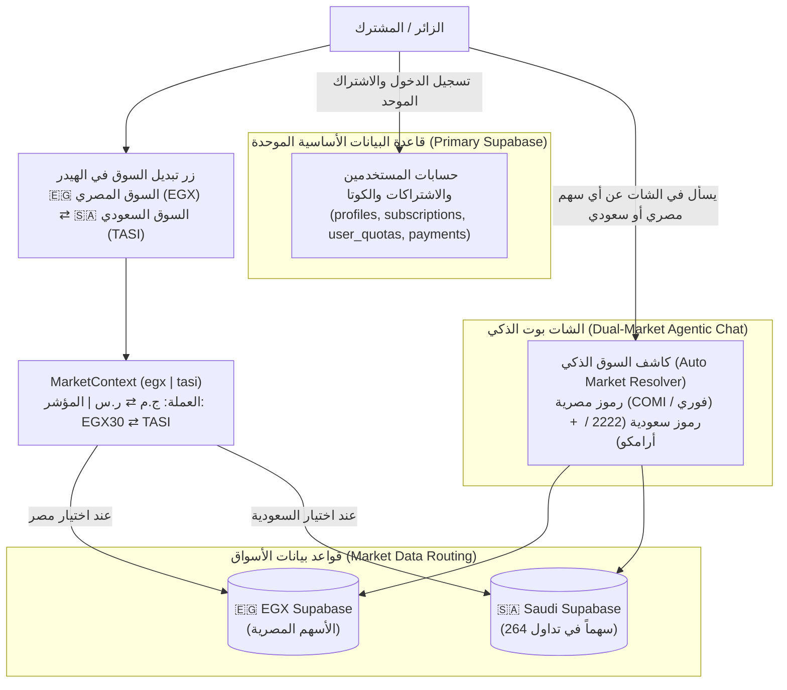

# 🇸🇦🇪🇬 خطة التوسع للسوق السعودي (Tadawul / TASI) — خطة تنفيذية خلال 48 ساعة

> **تاريخ الإنشاء:** 2026-11-14  
> **الحالة:** قيد التنفيذ (Active Roadmap)  
> **الهدف:** دمج السوق السعودي (تداول / TASI) بالكامل داخل منصة **EGX BOTS** بحيث يبدّل الزائر بضغطة زر بين **السوق المصري (🇪🇬 EGX)** و**السوق السعودي (🇸🇦 TASI)** عبر الموقع ككل، بينما يعمل **الشات بوت الذكي (Agentic AI Chat)** تلقائياً على السوقين معاً في نفس الوقت بدون قيود.

---

## 1. نتائج الفحص الفعلي للبنية التحتية الحالية (Current State Audit)

تم فحص قاعدة بيانات Supabase الخاصة بالسوق السعودي المسجلة في `.env` (`SAUDI_SUPABASE_URL` — `ughyugwlqbdxibklcddv.supabase.co`) وتبيّن أنها **جاهزة بنسبة كبيرة وبنفس هيكل الجداول (Schema) المطابق للسوق المصري**:

| الجدول / View في `SAUDI_SUPABASE` | عدد السجلات الحالي | الحالة | المطلوب |
|---|---:|---|---|
| `stocks` | **264 شركة** | ✅ جاهز (`exchange='TADAWUL'`, `currency='SAR'`) | تعريب حقل `name_ar` + إضافة المرادفات الشعبية (أرامكو، الراجحي، سابك...) |
| `stock_prices` | **734,490 سجل** | ✅ محدث حتى جلسة `2026-11-12` | ربط التحديث اليومي التلقائي في `daily_bot_run.py` |
| `stock_fundamentals` | **264 شركة** | ✅ جاهز (`data` + `fund_score`) | جاهز للاستخدام في القيمة العادلة والتحليل المالي |
| `market_index` | **4,105 سجل** | ✅ محدث حتى `2026-11-12` (`TADAWUL`) | جاهز للعرض في شريط المؤشر العلوي وأداة `get_market` |
| `stock_technical_indicators` | `0` | ⏳ الجدول موجود وفارغ | تشغيل حاسب المؤشرات الفنية على `stock_prices` (يستغرق أقل من دقيقة) |
| `scan_results` | `0` | ⏳ الجدول موجود وفارغ | تشغيل محرك الماسح الفني ومجلس النماذج على أسهم تاسي |
| `current_public_recommendations` | `0` | ⏳ الـ View/الجدول موجود وفارغ | يتعبأ تلقائياً مع توليد توصيات `scan_results` |
| `ai_scores` | `0` | ⏳ الجدول موجود وفارغ | تشغيل تقييم الذكاء الاصطناعي لأسهم تاسي |
| `market_heatmap` | `0` | ⏳ الجدول موجود وفارغ | توليد خريطة السيولة الحرارية من الأسعار والمؤشرات |
| `market_sectors_timeline` | `0` | ⏳ الجدول موجود وفارغ | توليد أداء القطاعات اليومي من الأسعار |

---

## 2. المعمارية التصميمية (Core Architecture)

### القواعد المعمارية الصارمة:
1. **حساب واحد واشتراك واحد للسوقين:**
   - تسجيل الدخول (`Auth`)، الكوتا اليومية (`user_quotas`)، المحفظة، والاشتراكات المدفوعة (`subscriptions`) تبقى **حصرياً على Supabase الرئيسي**.
   - المشترك في باقة Pro يتمتع بكامل مميزات السوق المصري والسوق السعودي معاً دون دفع اشتراك إضافي.
2. **توجيه قراءات بيانات السوق (`Market Data Routing`):**
   - الصفحات والأدوات العامة (الأسعار، التوصيات، الماسح الفني، المؤشرات، الأساسيات) تقرأ من `SUPABASE_URL` عندما يكون السوق `egx`، ومن `SAUDI_SUPABASE_URL` عندما يكون السوق `tasi`.
3. **الشات بوت مفتوح على السوقين في نفس اللحظة:**
   - لا يُجبر المستخدم على تبديل زر الموقع لكي يسأل الشات بوت عن سهم سعودي أو مصري.
   - إذا كتب المستخدم: *"حلل سهم أرامكو 2222"* أو *"قارن بين الراجحي 1120 والبنك التجاري الدولي COMI"*، يفهم الشات بوت كل رمز ويجلب بياناته من قاعدة بياناته الصحيحة مع عملته الصحيحة (`ر.س` أو `ج.م`).
   - في الأسئلة العامة غير المحددة بدولة (مثل: *"ما هي أفضل توصيات اليوم؟"* أو *"ما وضع السوق اليوم؟"*)، يستخدم الشات بوت السوق النشط حالياً في واجهة المستخدم (`active_market`) كافتراضي، أو يحدد السوق الذي ذكره المستخدم في سؤاله.

---

## 3. الأدوات التي سيتم تفعيلها للسوق السعودي خلال يومين

1. **🤖 الشات بوت الذكي ثنائي السوق (`/chat` & Floating Chat):**
   - دعم كامل للـ 9 أدوات على أسهم تداول (`get_stock`, `get_stock_levels`, `get_market`, `get_recommendations`, `get_technical_scan`, `get_accumulation_stocks`, `get_comparison`, `get_news`, `manage_portfolio`).
2. **🎯 التوصيات الذكية والصفقات القصيرة (`/recommendations` & Short Swings):**
   - إشارات الدخول، الأهداف، وقف الخسارة، ونسبة العائد للمخاطرة لأسهم تاسي بالريال السعودي (`ر.س`).
3. **📡 الماسح الفني وتتبع السيولة الذكية (`/scanner/technical`):**
   - اختراقات السيولة، تجميع الحيتان (Wyckoff)، المصائد السعرية، والمؤشرات الفنية لـ 264 شركة سعودية.
4. **📊 صفحة السهم التفصيلية وتقييم الأسهم (`/stocks/[symbol]`):**
   - الشارت، الدعوم والمقاومات، المؤشرات الفنية، والبيانات المالية الأساسية (`stock_fundamentals`).
5. **🌡️ نبض السوق وخريطة السيولة (`/market` & Header Ticker):**
   - مؤشر تاسي (`TASI`)، أداء القطاعات السعودية، والخريطة الحرارية.

---

## 4. خطة التنفيذ والمتابعة (Execution Checklist)

### المرحلة 1: تجهيز بيانات ومحرك السوق السعودي (اليوم 1 — الجزء الأول)
- [x] **1.1 تعريب أسماء الشركات السعودية ومرادفاتها (`api/saudi_stock_aliases.py`):**
  - تحديث حقل `name_ar` لـ 264 شركة في جدول `stocks` بقاعدة `SAUDI_SUPABASE` (أرامكو، الراجحي، سابك، إس تي سي، معادن، الأهلي، سليمان الحبيب، أكوا باور...).
  - إنشاء قاموس البحث العربي والإنجليزي والكود الرقمي (`2222` ⇄ `أرامكو` ⇄ `ARAMCO`).
- [x] **1.2 توليد المؤشرات الفنية وخريطة السوق لبيانات تاسي الحالية:**
  - تشغيل حساب المؤشرات الفنية (`stock_technical_indicators`) على الـ 264 سهماً من واقع الـ 734 ألف سجل أسعار في `SAUDI_SUPABASE`.
  - تعبئة جدول `market_heatmap` و `market_sectors_timeline` و `stock_scans_summary` (مع تقييد `obv_change_pct` ضمن `[-500, 500]`).
- [x] **1.3 توليد التوصيات والماسح الفني (`scan_results` & `current_public_recommendations`):**
  - تدريب نموذجي `api/models/KING_TASI.pkl` و `api/models/model_TADAWUL.pkl` وتشغيل محرك التوصيات والـ AI Scores على السوق السعودي لملء `scan_results` و `current_public_recommendations` و `ai_scores`.
- [x] **1.4 جدولة التحديث اليومي للسوق السعودي:**
  - ربط التحديث اليومي للسوق السعودي (`scripts.saudi_pipeline_bootstrap` بوضع `--reuse-models`) داخل `_execute_phase` في `api/daily_job_scheduler.py` بعد إكمال مهمة الإغلاق (`phase == "close"`) بشكل معزول (`try/except`)، وإضافة الملفات إلى `FILES_TO_SYNC` في `scripts/sync_to_hf_space.py`.

---

### المرحلة 2: الشات بوت الذكي مفتوح على السوقين (اليوم 1 — الجزء الثاني)
- [x] **2.1 تهيئة اتصال `saudi_supabase` في الباك إند (`api/stock_ai.py` & `api/agentic_chat/tools_execution.py`):**
  - إنشاء دالة `_get_sb_for_market(market="EGX")` / `_get_sb()` تُرجع عميل Supabase المصري أو السعودي حسب السوق.
- [x] **2.2 كاشف السوق التلقائي للرموز (`_resolve_symbol_and_market`):**
  - إذا كان الرمز رقماً رباعياً سعودياً (`1010`–`9999` أو ينتهي بـ `.SR`) أو اسماً في قاموس الأسهم السعودية ← يوجّه تلقائياً إلى `TASI` (`saudi_supabase`).
  - إذا كان رمزاً مصرياً (`COMI`, `FWRY`...) أو اسماً في قاموس الأسهم المصرية ← يوجّه إلى `EGX` (`supabase`).
- [x] **2.3 ترقية أدوات الشات بوت الـ 9 لدعم السوقين:**
  - إضافة بارامتر اختياري `market: Optional[str] = None` في `tools_schema.py` و `tools_execution.py`.
  - إرجاع العملة (`SAR` / `ر.س` للسعودي و `EGP` / `ج.م` للمصري) واسم البورصة (`TASI` / `EGX`) ضمن نتائج كل أداة.
- [x] **2.4 تحديث توجيهات النموذج (`api/agentic_chat/prompts.py`):**
  - تعريف DeepSeek-V3 بأنه يدعم البورصة المصرية (EGX) والسوق السعودي (تداول TASI) معاً، مع مراعاة فروق العملة (`ج.م` مقابل `ر.س`) ونسبة التذبذب اليومي في تاسي (±10%).

---

### المرحلة 3: زر تبديل السوق وسياق الواجهة الأمامية (اليوم 2 — الجزء الأول)
- [x] **3.1 إنشاء `MarketContext.tsx` في `web/src/contexts/MarketContext.tsx`:**
  - الحالة العامة: `market: "egx" | "tasi"` (مع حفظ الاختيار في `localStorage` و Cookie `egxbots_market`).
  - الخصائص المساعدة: `isSaudi`, `currencyLabel` (`ج.م` / `ر.س`), `exchangeLabel` (`EGX` / `TASI`), `indexLabel` (`EGX30` / `TASI`).
- [x] **3.2 إنشاء عميل Supabase ثنائي السوق في الفرونت إند (`web/src/lib/supabase/`):**
  - دالة `createMarketSupabaseBrowserClient(market)` في `browser.ts` وعملاء التوجيه العام/الخادم في `route-data.ts` تقرأ من `NEXT_PUBLIC_SAUDI_SUPABASE_URL` / `SAUDI_SUPABASE_URL` عند اختيار `tasi`.
- [x] **3.3 تصميم زر التبديل في الهيدر (`web/src/components/Header.tsx`):**
  - زر سريع وواضح في الـ Header (للموبايل والديسكتوب): `🇪🇬 مصر (EGX)` ⇄ `🇸🇦 السعودية (TASI)`.
  - تحديث شريط المؤشر العلوي في الـ Header ليعرض مؤشر `TASI` عند اختيار السعودية، وتحديث شريط البحث الفوري ليبحث في أسهم السوق المختار.

---

### المرحلة 4: ربط صفحات الأدوات + الاختبار والرفع (اليوم 2 — الجزء الثاني)
- [x] **4.1 ربط صفحة الماسح الفني (`/scanner/technical` & `TechnicalScannerContext`):**
  - إعادة جلب بيانات الماسح الفني تلقائياً عند تغيير `market` في `MarketContext` وتغيير العملة المعروضة إلى `ر.س`.
- [x] **4.2 ربط صفحات التوصيات والصفقات القصيرة (`RecommendationsTable`, `LandingClient`, `/scanner/ai`, `AIScannerContext`, `/api/ai_bot/recommendations`):**
  - عرض توصيات تاسي والصفقات القصيرة للسوق السعودي عند تفعيل الوضع السعودي.
- [x] **4.3 ربط صفحة تفاصيل السهم (`/stocks/[symbol]`) وملخص السوق (`/scanner/market`):**
  - دعم فتح أي سهم سعودي (مثل `/stocks/2222`) وعرض الشارت والمؤشرات والبيانات المالية بالريال السعودي.
- [x] **4.4 إعداد متغيرات البيئة والنشر (`Vercel` + `Hugging Face Space`):**
  - تم إنشاء وتشغيل الهجرة `supabase/migrations/20261114130000_saudi_supabase_functions_triggers_timeouts.sql` على `SAUDI_SUPABASE` (`ughyugwlqbdxibklcddv`) وتفعيل الـ 9 دوال/RPCs، والـ 4 Triggers، ورفع حدود `statement_timeout` (`120s` لـ `service_role` و`60s` لـ `authenticator`).
  - تم ضبط متغيرات البيئة الخمسة (`SAUDI_SUPABASE_URL`, `SAUDI_SUPABASE_ANON_KEY`, `SAUDI_SUPABASE_SERVICE_ROLE_KEY`, `NEXT_PUBLIC_SAUDI_SUPABASE_URL`, `NEXT_PUBLIC_SAUDI_SUPABASE_ANON_KEY`) محلياً وفي مشروع Vercel (`egxbots` — `prj_kvgWiiBMdlFBLMX6sYx8ewJBS7Y7`) وفي أسرار Hugging Face Space (`weeasdwee/AI_BOT`).
  - تم رفع نموذجي `api/models/KING_TASI.pkl` و `api/models/model_TADAWUL.pkl` وكامل ملفات الباك إند المحدثة إلى Hugging Face Space (`weeasdwee/AI_BOT`) عبر `scripts/sync_to_hf_space.py` *(يبقى فقط `git push` لكود الواجهة الأمامية لـ Vercel معلّقاً بانتظار أمر المستخدم الصريح التزاماً بقاعدة عدم الدفع التلقائي إلى Git)*.

---

## 5. سجل التقدم (Progress Log)

| التاريخ | المرحلة | ما تم إنجازه | الحالة |
|---|---|---|---|
| 2026-11-14 | التخطيط والفحص | فحص `SAUDI_SUPABASE` والتأكد من وجود 264 شركة سعودية و734,490 سجل أسعار حتى `2026-11-12` وكتابة خطة التنفيذ | ✅ مكتمل |
| 2026-11-14 | المراحل 1–4 (التنفيذ والتحقق المحلي) | **بيانات `SAUDI_SUPABASE` والنماذج (`Track 1`):** مواءمة الـ Schema وRLS، تعريب 264 شركة (`stocks.name_ar=264` عبر `api/saudi_stock_aliases.py` باجتياز 264/264 لاختبار المرادفات)، تعبئة 264 سجل أساسيات ومؤشرات فنية و`stock_scans_summary` (مع تقييد `obv_change_pct` ضمن `[-500, 500]` وتنظيف الـ 263 سجل المتجاوزة لتصبح 0 خارج النطاق) و`market_heatmap` و1,377 سجل `market_sectors_timeline` و528 `ai_scores` و17 توصية في `scan_results` / `current_public_recommendations` (8 open, 4 win, 5 loss) و5 مفاتيح `market_cache`، وتدريب `api/models/KING_TASI.pkl` (34 ميزة، `AUC=0.6041`) و`api/models/model_TADAWUL.pkl` (57 ميزة، `AUC=0.6062`)، وربط التحديث اليومي المعزول بعد الإغلاق في `api/daily_job_scheduler.py` وإضافته لقائمة `scripts/sync_to_hf_space.py`. **الشات بوت ثنائي السوق:** دعم أدوات الشات بوت الـ 9 لـ `EGX` و`TASI` معاً في `api/agentic_chat/` (48/48 pytest لاختبارات الشات العازلة والمحلية، وبإجمالي 55/55 pytest في تحقق مسار الشات). **الواجهة الأمامية:** تفعيل `MarketContext` ومبدّل الهيدر في `Header.tsx` وربط `/scanner/market` و`/scanner/technical` و`/stocks/[symbol]` و`RecommendationsTable` / `/scanner/ai`. | ✅ مكتمل |
| 2026-11-14 | المرحلة 4.4 (إعداد الدوال وبيئة الإنتاج والنشر على HF Space) | تطبيق `20261114130000_saudi_supabase_functions_triggers_timeouts.sql` على `SAUDI_SUPABASE` (9 دوال، 4 Triggers، وTimeouts `120s`/`60s`/`30s`، والتحقق الحي من RPCs لـ 264 سهماً)، وحقن متغيرات البيئة الـ 5 في Vercel (`prj_kvgWiiBMdlFBLMX6sYx8ewJBS7Y7`) وأسرار HF Space (`weeasdwee/AI_BOT`)، ورفع `KING_TASI.pkl` و`model_TADAWUL.pkl` وملفات الباك إند المحدثة إلى `weeasdwee/AI_BOT` *(مع بقاء `git push` للواجهة الأمامية بانتظار أمر المستخدم الصريح)*. | ✅ مكتمل (بانتظار `git push` بأمر المستخدم) |
