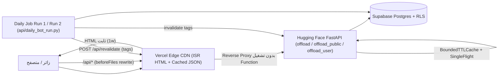

# Vercel Zero-CPU Architecture (معمارية تصفير استهلاك فيرسيل)

> **الحالة:** معتمد ومطبّق في الإنتاج منذ 2026-11-17 (Git `bf3665dc`، HF Space `a03cb24c`).
> **الجمهور:** كل الـ Agents (Planner / Developer / QA / Subagents) وأي مطوّر يعدّل `web/` أو `api/`.
> **القاعدة الذهبية:** فيرسيل = **واجهة عرض + كاش CDN فقط**. أي حساب أو استعلام قاعدة بيانات أو LLM يتنفّذ على **Hugging Face (FastAPI)** مرة واحدة ويتكيّش.

---

## 1. ليه الملف ده موجود؟ (المشكلة)

- خطة Vercel Hobby فيها حد شهري **4 ساعات Fluid Active CPU**.
- قبل التعديل كان الاستهلاك **~5–6 دقائق يومياً** (≈ 3 ساعات/شهر) وده كان هيخلّص الكوتا.
- أكبر المستهلكين (من Vercel Observability → Functions، آخر 12 ساعة قبل التعديل):

| المسار | Active CPU | السبب |
|---|---|---|
| `/stocks/[symbol]` | 56s (392 استدعاء) | إعادة بناء ISR لكل صفحات الأسهم بعد كل تشغيل يومي |
| `/api/revalidate` | 9s | كان بيعيد حساب استعلامات السوق جوه فيرسيل |
| `/api/portfolio`, `/api/scan/*`, `/api/profile/telegram-pro`, `/api/automations`, ... | 1.7s – 4.1s لكل مسار | Route Handlers بتستعلم Supabase من فيرسيل |
| `/reports/[date]/[kind]` | 2.76s | توليد التقارير عند أول زيارة/زحف |

**الهدف:** أقرب ما يمكن من `0s/day` بدون ما البيانات اليومية تقف عن التحديث بعد التشغيل التاني (Run 2).

---

## 2. الصورة الكبيرة (Architecture Overview)



| الطبقة | المسؤولية | ممنوع فيها |
|---|---|---|
| **Vercel (Next.js 15)** | HTML ثابت عبر ISR، كاش CDN، Auth callback، لوحة الأدمن | استعلامات Supabase ثقيلة، LLM، تجميعات، polling |
| **Hugging Face (FastAPI)** | كل الـ APIs العامة والخاصة، الحسابات، الكاش في الذاكرة، البوتات، الـ jobs | نشر ملفات `web/` أو صور أو docs عليه |
| **Supabase** | التخزين + RLS + Auth | قراءة اللوجات في المراجعات الروتينية |

---

## 3. المصطلحات البرمجية للأنماط المستخدمة (Design Patterns Glossary)

> الجدول ده هو "اللغة المشتركة" بين الـ Agents. لما تقترح أو تراجع تعديل، سمّي النمط باسمه.

| # | المصطلح (CS Term) | المعنى ببساطة | فين متطبّق عندنا |
|---|---|---|---|
| 1 | **Compute Offloading** | نقل الحساب من بيئة مكلفة/محدودة لبيئة أرخص | كل `/api/*` الثقيلة → HF |
| 2 | **Reverse Proxy / Edge Rewrite** | الـ CDN يمرر الطلب لسيرفر تاني من غير ما يشغّل كود | `beforeFiles` في `web/next.config.js` |
| 3 | **BFF (Backend-for-Frontend)** | باك إند مخصص يخدم الواجهة بالشكل اللي محتاجاه بالظبط | `api/routers/offload_public.py` و`offload_user.py` |
| 4 | **Strangler Fig Pattern** | استبدال تدريجي للنظام القديم مع إبقائه كـ fallback | ملفات `route.ts` المحلية باقية للـ Jest ولـ `OFFLOAD_TO_HF=false` |
| 5 | **SSG / ISR (Incremental Static Regeneration)** | توليد HTML مرة وتخزينه، وإعادة توليده بعد مدة أو عند حدث | `export const revalidate = 604800` |
| 6 | **Static Shell + Client Hydration** | صفحة ثابتة سريعة، والأرقام الحية تتجاب في المتصفح | `/stocks/[symbol]` ← `/api/public/stock-page-data` |
| 7 | **Event-Driven Cache Invalidation** | الكاش يتمسح لما الحدث يحصل (نهاية الـ job) مش بالوقت | `api/cache_invalidation.py` → `/api/revalidate` |
| 8 | **Tag-Based Invalidation (Surrogate Keys)** | كل كاش له "تاج"، ونمسح بالتاج بدل ما نمسح كل حاجة | `daily-market-data`, `daily-symbols`, ... |
| 9 | **Selective / Scoped Invalidation** | امسح بس اللي اتغيّر فعلاً | `select_cache_tags()` بتختار التاجز حسب الخطوات الناجحة |
| 10 | **Cache Decoupling** | فصل صفحة عن تاج متقلّب عشان متتبنيش كل يوم | `/stocks/[symbol]` بيستخدم `getPublicStockDirectoryWeekly` بدون تاج |
| 11 | **Stale-While-Revalidate (SWR)** | قدّم النسخة القديمة فوراً وحدّث في الخلفية | هيدر `stale-while-revalidate=2592000` + تحديث خلفي في الـ Client |
| 12 | **Cache-Aside (Lazy Loading)** | اقرأ من الكاش، لو فاضي هات من المصدر واملاه | `BoundedTTLCache.get()` ثم الاستعلام ثم `.set()` |
| 13 | **LRU + TTL Eviction** | حد أقصى لعدد العناصر + مدة صلاحية | `api/perf_utils.py` → `BoundedTTLCache` |
| 14 | **Request Coalescing / Single-Flight** | 100 طلب متزامن = استعلام واحد للمصدر | `SingleFlight().do(key, fn)` |
| 15 | **Cache Stampede / Thundering Herd Prevention** | منع انهيار المصدر لما الكاش يخلص لكل الناس مرة واحدة | Single-Flight + SWR |
| 16 | **Debouncing** | تجاهل التكرار خلال نافذة زمنية | `REVALIDATE_COOLDOWN_SECONDS` (افتراضي 120s) |
| 17 | **Run-to-Run Caching** | الكاش يعيش من تشغيل يومي للتشغيل اللي بعده ويتمسح بالحدث | `_RUN_TO_RUN_TTL = 86400` على HF + مسح بالتاج |
| 18 | **Monotonic Freshness Guard** | ممنوع بيانات أقدم تكتب فوق بيانات أحدث | `shouldPreferFreshFairValueReport()` |
| 19 | **Cache Key Isolation / Cache Poisoning Prevention** | ممنوع ردّ مبني على كوكي يتكيّش عام لكل الناس | `_daily_headers` فقط مع `?market=` صريح، غير كده `_private_headers` |
| 20 | **Zero-Trust / Fail-Closed Auth** | لا نثق في أي `user_id`/`is_pro` جاي من العميل، والفشل = رفض | `resolve_verified_viewer()` |
| 21 | **Projection Pushdown + Bounded Queries** | اختار أعمدة محددة + `limit()` دايماً | ممنوع `select("*")` على الجداول الكبيرة |
| 22 | **Graceful Degradation / Fallback** | لو HF وقع، الصفحة تشتغل بآخر نسخة سليمة | `fetchHfPublicJson` يرجّع `null` → fallback، وISR يحتفظ بآخر HTML |
| 23 | **Build-Time Pre-rendering** | توليد الصفحات وقت الـ build بدل وقت الزيارة | `generateStaticParams()` لآخر 60 تقرير |
| 24 | **Idempotency** | تكرار نفس الطلب ميعملش أثر مزدوج | `requestId` في معاملات المحفظة، `event_id` في revalidate |

---

## 4. القواعد التفصيلية

### 4.1 Edge Rewrites (`web/next.config.js`)
- أي API جديد يقرأ Supabase أو يحسب حاجة → **لازم** يتكتب في FastAPI على HF ويتضاف لـ `offloadBeforeFiles`.
- `beforeFiles` يتنفّذ **قبل** Route Handlers ⇒ **0ms** Fluid Active CPU.
- `afterFiles` **مش كفاية** لو فيه `route.ts` بنفس المسار (الملف هيكسب ويشتغل على فيرسيل).
- مفتاح الطوارئ: `OFFLOAD_TO_HF=false` يرجّع كل حاجة لـ `route.ts` المحلية (للتشخيص فقط).
- `web/src/middleware.ts` لازم يفضل `matcher: []` (أي matcher = تشغيل Edge مع كل طلب).

### 4.2 ISR ومدد الكاش
| النوع | القيمة | أمثلة |
|---|---|---|
| صفحات عامة يومية البيانات | `revalidate = 604800` (1w) + تاج يومي | `/fair-value`, `/sharia`, `/stocks`, `/scanner/*`, `/sitemap.xml` |
| صفحات أسهم فردية | `604800` **بدون** تاج يومي + تحديث من المتصفح | `/stocks/[symbol]` |
| أرشيف/تقارير | `604800` + `generateStaticParams` | `/reports`, `/reports/[date]/[kind]` |
| محتوى ثابت | `604800` | `/pricing`, `/blogs/[slug]` |

**ممنوع:** `revalidate = 86400` أو أقل على صفحة عامة جديدة إلا بسبب موثّق. الـ freshness بتيجي من **الحدث** (invalidate) مش من الوقت.

### 4.3 التاجز اليومية وربطها بالتشغيل (Run 1 / Run 2)
التاجز معرفة في `web/src/lib/cache/daily.ts` و`api/cache_invalidation.py`:

| التاج | يتمسح لما تنجح | يأثر على |
|---|---|---|
| `daily-market-data` | `sync_prices` + `calculate_indicators` | القيمة العادلة، الشرعي، الماسحات، كاش HF للسوق |
| `daily-symbols` | `sync_inventory` | دليل الأسهم `/stocks`، الـ sitemap |
| `daily-recommendations` | `generate_recommendations` أو `evaluate_recommendations` | التوصيات وماركرات الشارت |
| `daily-news-data` | `news_sentiment` | الأخبار |
| `daily-public-reports` | `social_reports_ready` | `/reports/*`، sitemap posts |
| `daily-short-swings` | `short_swings_daily` | السوينجات القصيرة |
| `daily-disclosures` | `egx_disclosures` | الإفصاحات |

تسلسل الحدث بعد كل تشغيل:
1. `invalidate_daily_cache(steps_log)` → `select_cache_tags()` تختار التاجز الآمنة فقط (لو `sync_prices` فشل ⇒ ولا تاج).
2. `invalidate_local_hf_caches(tags)` تمسح كاش الذاكرة في HF فوراً.
3. `POST /api/revalidate` بالتاجز ⇒ `revalidateTag()` + `invalidateByTag()` على فيرسيل.
4. أول زائر بعد كده ياخد نسخة جديدة؛ الباقي ياخدوا من الـ CDN.

**مهم جداً:** أي `unstable_cache` بيستدعي `fetchHfPublicJson` لازم يمرر **نفس التاجز** للـ `fetch` الداخلي:
```ts
fetchHfPublicJson(path, 604800, 5000, [DAILY_CACHE_TAGS.market]);
```
وإلا الـ Data Cache الداخلي هيفضل بالبيانات القديمة حتى بعد `revalidateTag`.

`/api/revalidate` **لا** يشغّل `refreshMarketQueries` إلا بـ `?refresh_kv=true` صريح.

### 4.4 التحديث من المتصفح (Client-Side Freshness)
- الأرقام الحية تتجاب من `/api/public/*` أو `/api/market/*` (تمر لـ HF بـ 0 CPU).
- لو الصفحة عندها `initialReport` من SSR: اعرضه فوراً، وحدّث في الخلفية بـ `{ forceRefresh: true }` (يتخطى `sessionStorage` ويستخدم `cache: "no-cache"`).
- **لا تكتب** النتيجة إلا لو أحدث: `shouldPreferFreshFairValueReport(data, initialReport)`.
- متصفّرش فلاتر المستخدم أثناء التحديث الخلفي.
- ممنوع polling أقل من 30s، ويفضّل التحديث عند الحدث/الفوكس.

### 4.5 هيدرز الكاش على HF
```python
_daily_headers(tag)    # public, max-age=3600, s-maxage=604800, stale-while-revalidate=2592000 + Vercel-Cache-Tag
_private_headers(tag)  # private, no-store, max-age=0
```
- `_daily_headers` **فقط** لو الطلب فيه `market`/`country`/`exchange` صريح في الـ URL.
- السوق المحدد بالكوكي ⇒ `_private_headers` (وإلا مستخدم سعودي ياخد كاش مصري).
- أي `POST` أو بيانات مستخدم ⇒ `_private_headers` دايماً.

### 4.6 كاش الذاكرة في HF
```python
_X_CACHE = BoundedTTLCache(max_entries=N, default_ttl=_RUN_TO_RUN_TTL)
_X_SF = SingleFlight()
found, val = _X_CACHE.get(key)
if not found:
    val = _X_SF.do(key, lambda: _load_x(key))
    _X_CACHE.set(key, val)
```
- كل كاش جديد لازم يتسجل في `_PUBLIC_TAG_TO_CACHES` / `_TAG_TO_CACHES` / `invalidate_user_router_public_caches` عشان يتمسح بالتاج.
- **ممنوع** وضع بيانات مستخدم (محفظة، حصة، اشتراك) في كاش مفتاحه عام.

### 4.7 توافق Supabase Python (`supabase==2.5.3` / `postgrest==0.16.11`)
- ❌ `.insert(...).select(...)` / `.update(...).select(...).single()` ⇒ `AttributeError`.
- ❌ `.maybe_single()` ⇒ يرمي خطأ على 204 لما مفيش صفوف.
- ✅ استخدم `_select_one(query)` (`limit(1).execute()`) و`_first_row(result)` من `api/routers/offload_user.py`.
- الـ `_FakeQuery` في `api/tests/test_offload_full_router.py` بيحاكي القيود دي؛ أي اختبار جديد لازم يستخدمه.

---

## 5. اللي لسه بيستهلك CPU على فيرسيل (Known Residual Consumers)
مقبول ومحدود، بس خلي بالك منه:
- إعادة توليد ISR بعد مسح تاج (مرة لكل صفحة لكل تشغيل، مش لكل زائر).
- `/api/admin/*` (لوحة الأدمن) و`/auth/callback` (تسجيل الدخول).
- `/blogs/chat/[slug]` و`/b2b/dashboard` (Dynamic).
- `/api/revalidate`, `/api/indexnow`, `/api/cron/*`, `/api/voice/*`, `/api/support/tg-webhook/[token]`.

أي إضافة جديدة للقائمة دي محتاجة مبرر مكتوب في الـ PR/الرد.

---

## 6. Checklist إلزامية لأي Feature جديدة
- [ ] الـ API الجديد متكتب في FastAPI على HF ومضاف لـ `offloadBeforeFiles`؟
- [ ] الصفحة العامة `revalidate = 604800` ومربوطة بتاج يومي (أو مفصولة عنه بقصد)؟
- [ ] `fetchHfPublicJson` بيمرر التاجز الصح؟
- [ ] الكاش الجديد على HF مسجل في خريطة التاجز؟
- [ ] الاستعلامات فيها أعمدة محددة + `limit()`؟ مفيش `select("*")`؟
- [ ] مفيش `.maybe_single()` ولا `.select()` بعد `insert/update`؟
- [ ] بيانات المستخدم `private, no-store` ومعزولة عن الكاش العام؟
- [ ] الهوية من `resolve_verified_viewer()` مش من الـ body/query؟
- [ ] مفيش polling < 30s ولا middleware matcher جديد؟
- [ ] اختبارات offline (pytest / Jest) قبل أي نداء حي، وQA Reviewer = PASS؟
- [ ] رفع HF = ملفات Python/config فقط عبر `scripts/sync_to_hf_space.py`، و`git push` بس بأمر صريح من المستخدم؟

---

## 7. الملفات المرجعية
| الملف | الدور |
|---|---|
| `web/next.config.js` | قواعد `beforeFiles` للـ offload |
| `web/src/middleware.ts` | `matcher: []` |
| `web/src/lib/hf-public-read.ts` | `fetchHfPublicJson` مع تمرير التاجز |
| `web/src/lib/cache/daily.ts` | أسماء التاجز اليومية |
| `web/src/app/api/revalidate/route.ts` | نقطة المسح من الـ job |
| `web/src/lib/api.ts` | `fetchDailyPublicJsonCached` + `forceRefresh` |
| `web/src/lib/market/fair-value.ts` | `shouldPreferFreshFairValueReport` |
| `api/perf_utils.py` | `BoundedTTLCache`, `SingleFlight` |
| `api/cache_invalidation.py` | اختيار التاجز + مسح HF + نداء فيرسيل |
| `api/routers/offload.py`, `offload_public.py`, `offload_user.py` | الـ BFF على HF |
| `scripts/sync_to_hf_space.py` | النشر لـ HF (Python فقط) |
| `docs/SYSTEM_ARCHITECTURE_AND_CDN_EDGE.md` | DNS والـ Edge (حارس مزودي الإنترنت المصريين) |
