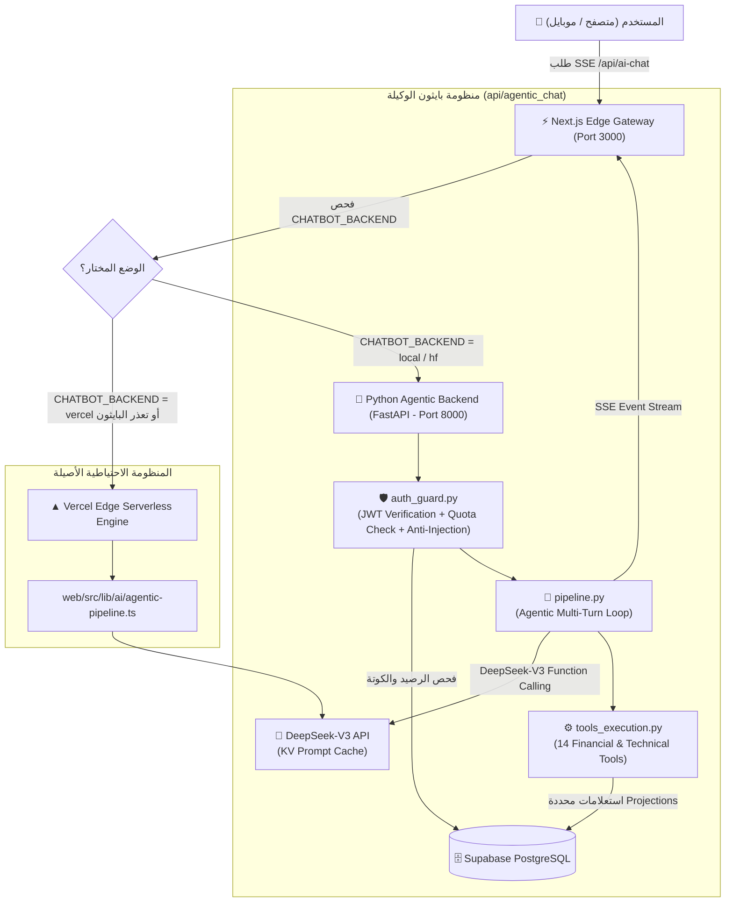

# معمارية الشات بوت الوكيل المستقل على بايثون (Python Agentic Chatbot Engine)
> **تاريخ الاعتماد والتوثيق:** 10 نوفمبر 2026  
> **الحالة:** معتمدة رسمياً ودائماً للإنتاج (Official Permanent Production Architecture)  
> **المحرك الإنتاجي الدائم (Production Engine):** Hugging Face Space (`weeasdwee-ai-bot.hf.space/api/ai_chat`)  
> **المحرك المحلي (Local Development):** FastAPI on `http://127.0.0.1:8000/api/ai_chat`  
> **حالة مسار فيرسيل (Vercel Status):** ملغي تماماً (Zero Vercel CPU - مسار `web/src/app/api/ai-chat/route.ts` تحول إلى Lightweight Proxy فقط مع تفريغ المعالجة في `beforeFiles`)  
> **منهجية التوجيه:** Vercel/Next.js `beforeFiles` و `afterFiles` Rewrites الافتراضية دائماً إلى بايثون.

---

## 1. الدوافع والأهداف المعمارية (Architectural Motivation)

1. **القضاء على استهلاك Vercel Active CPU (Zero-Vercel-CPU Strategy):**
   - الشات بوت الوكيل يقوم باستدعاء أدوات متعددة بالتوازي، وقد يحتاج من دورة إلى ثلاث دورات (Multi-turn tool loop) لجمع البيانات وتنسيق الإجابة في بث لحظي (Streaming SSE).
   - تشغيل هذه الدورات الطويلة على دوال Vercel Serverless كان يستهلك دقائق من كوتة الـ Active CPU الثمينة (4 ساعات شهرياً في الحساب المجاني).
   - بنقل الشات بوت إلى خادم بايثون (محلياً أو على Hugging Face Space الدائم)، ينخفض استهلاك Vercel Active CPU إلى **0%**، حيث يقتصر دور فيرسيل على تمرير الـ Streaming فقط كـ Proxy شفاف.

2. **الانسجام التقني مع نماذج ومكتبات التحليل الفني (Python Native Ecosystem):**
   - مؤشرات المنصة، واستراتيجيات التجميع، ومكتبات التحليل المالي، وحسابات وايكوف مكتوبة بالفعل في بيئة Python.
   - تشغيل الشات بوت داخل نفس البيئة يتيح الوصول المباشر إلى الدوال الرياضية والتحليلية وخوارزميات الذكاء الاصطناعي دون الحاجة لتكرار برمجتها في TypeScript.

3. **الاعتمادية العالية وسياسة الـ Zero Downtime / Dual Engine:**
   - لم يتم حذف أو تغيير كود Vercel الأصلي في `web/src/lib/ai/` و `web/src/app/api/ai-chat/route.ts`.
   - كود Vercel يعمل كـ **Fallback دائم وتلقائي**؛ في حال تعطل سيرفر بايثون أو الحاجة لإجراء صيانة، يمكن إعادة التوجيه إلى Vercel بضغطة زر دون توقف الخدمة.

---

## 2. مخطط المعمارية والتدفق (System Architecture Flow)



---

## 3. تفاصيل مكونات المنظومة الجديدة (`api/agentic_chat/`)

| الملف | المسؤولية المعمارية والوظيفية |
| :--- | :--- |
| **`router.py`** | موجه مسارات FastAPI الرئيسية (`/api/ai_chat/stream`, `/sessions`, `/settings`, `/health`). يدير الـ SSE البث اللحظي، وحفظ الرسائل في الخلفية بدون حجب (`_persist_message_background`) داخل جدول `ai_chat_messages`. |
| **`auth_guard.py`** | - استخراج وتدقيق هوية المستخدم عبر Supabase JWT.<br/>- خصم رسائل الشات والتحقق من الكوتة اليومية عبر RPC `consume_chat_message` المعتمدة لمنع التلاعب وتطبيق باقات Free و Pro.<br/>- تطهير المدخلات (Input Sanitization) ومنع الـ Prompt Injection.<br/>- حماية عمليات المحفظة (`anti_injection_portfolio_check`). |
| **`pipeline.py`** | - المحرك الوكيل (Agentic Loop) الداعم لاستدعاء الأدوات حتى 3 جولات متتالية.<br/>- دعم الـ Prompt Caching بتثبيت التعليمات وتوقيت القاهرة في بادئة الرسائل.<br/>- بث التوكنز الفعلي الحقيقي (`{"type": "token"}`) دون تأخيرات مصطنعة.<br/>- إرسال أحداث الأدوات المستدعاة والجداول المنفذة. |
| **`tools_schema.py`** | تعريفات الـ 14 أداة المعيارية المتوافقة مع DeepSeek / OpenAI Function Calling مع توصيف دقيق باللغة العربية لشروط استدعاء كل أداة. |
| **`tools_execution.py`** | المنفذ الفعلي للأدوات (Dispatcher) مع التحويل غير المتزامن (`asyncio.to_thread`)، والالتزام الصارم بقواعد **Zero Log / DB Waste** وتحديد الحقول المستعلمة Projections بدقة. |
| **`prompts.py`** | برومبت النظام المعتمد (System Prompt)، وحوكمة الاستشارات المالية، وفرض الدقة الرقمية، وقواعد عرض الأسهم ومصادر البيانات. |

---

## 4. قائمة الأدوات الـ 14 المدعومة بالباك إند (Supported Tools)

1. **`get_stock`**: جلب السعر اللحظي، التغير اليومي، مؤشرات RSI و MACD، وحالة التوافق الشرعي، وسكورات King AI و EGX AI.
2. **`get_stock_levels`**: حساب مستويات الدعم والمقاومة (S1, S2, R1, R2)، ومنطقة الدخول المقترحة، والوقف (Stop Loss)، والمستهدفات (Targets).
3. **`get_market`**: نظرة عامة على مؤشر EGX30، مؤشر الشريعة EGX33، حجم وسيولة السوق، وقوائم الأسهم الرابحة والخاسرة والأنشط.
4. **`get_recommendations`**: استعراض التوصيات الفنية الحية المفتوحة (لحظية 15 دقيقة / سوينغ قصير / متوسط) مع دعم فلترة الأسهم المتوافقة مع الشريعة.
5. **`get_technical_scan`**: الماسح الفني لاكتشاف التباعدات الإيجابية والسلبية (Divergence) والاختراقات الفنية.
6. **`get_accumulation_stocks`**: رادار التجميع المؤسسي والسيولة الذكية بمنهجية وايكوف (Wyckoff).
7. **`get_news`**: آخر الأخبار والإفصاحات الرسمية للشركات المقيدة الصادرة في البورصة.
8. **`get_comparison`**: مقارنة تفصيلية متوازية بين شركتين أو أكثر بالبيانات الفنية والمالية.
9. **`get_fair_value`**: حساب القيمة العادلة، ومضاعفات الربحية (P/E)، ومكررات القيمة الدفترية، ومقارنتها بمتوسط القطاع.
10. **`get_sharia_cleanser`**: حاسبة التطهير الشرعي لحساب المبالغ الواجب إخراجها بدقة بناءً على نسب التطهير الرسمية وتوزيعات الكوبونات.
11. **`manage_portfolio`**: إدارة المحفظة الآمنة والمحصنة ضد الحقن (عرض المراكز، إضافة سهم، تعديل كمية/سعر، حذف، تصفية كاملة).
12. **`calculate_position`**: حساب الأرباح والخسائر ونسب العائد لمركز افتراضي لحظي دون حفظه في المحفظة.
13. **`enable_autonomous_recommendations`**: تفعيل وضع التوصيات الحرة المستقلة للذكاء الاصطناعي.
14. **`disable_autonomous_recommendations`**: إيقاف وضع التوصيات الحرة والعودة للوضع القياسي.

---

## 5. تكوين التوجيه في الواجهة (`web/next.config.js`)

تم إعداد التوجيه باستخدام مصفوفة `beforeFiles` في Next.js:

```javascript
// web/next.config.js
const chatbotBackend = (process.env.CHATBOT_BACKEND || "vercel").toLowerCase().trim();
const isPythonChatbot = chatbotBackend === "local" || chatbotBackend === "hf";

const pythonChatbotDestination = chatbotBackend === "local"
  ? "http://127.0.0.1:8000/api/ai_chat/:path*"
  : `${BACKEND_URL}/api/ai_chat/:path*`;

const pythonChatbotExact = chatbotBackend === "local"
  ? "http://127.0.0.1:8000/api/ai_chat"
  : `${BACKEND_URL}/api/ai_chat`;

const beforeFiles = isPythonChatbot
  ? [
      {
        source: '/api/ai-chat/:path*',
        destination: pythonChatbotDestination,
      },
      {
        source: '/api/ai-chat',
        destination: pythonChatbotExact,
      },
    ]
  : [];
```

---

## 6. التحصينات الدفاعية المضافة للفرونت إند

في ملف `web/src/components/chat/FormattedChatMessage.tsx`:
- تمت إضافة فحوصات أمان دفاعية متقدمة (`safeHeaders` و `safeRows`) لمعالجة تدفق الجداول أثناء الـ SSE Streaming.
- يمنع حدوث أخطاء الانهيار غير المعالجة (`TypeError: Cannot read properties of undefined (reading 'map')`) في حال وصول دفعة توكنز مجتزأة لجدول أثناء الصياغة.

---

## 8. معمارية الكاش الذكي ثنائي الطبقات (Model-Driven Two-Tier Cache) — 12 نوفمبر 2026

تم نقل وتطوير معمارية الكاش الذكي من بيئة TypeScript/Vercel السابقة إلى محرك بايثون بالكامل (`api/agentic_chat/analysis_cache.py`) مع تحقيق 4 ركائز معمارية رئيسية:

1. **استنباط النية عبر النموذج بدون Regex (Model-Driven Intent Resolution):**
   - بدلاً من مطابقة النصوص المعقدة بـ Regex هش قد يفشل أمام اللهجات، يقوم المحرك في الجولة الأولى (Round 1) باعتراض قرار DeepSeek في استدعاء الأداة (Function Calling Intent).
   - إذا قرر DeepSeek استدعاء أداة سهم قياسية (`get_stock(symbol="FWRY")`) أو أداة عامة (`get_market(metric="top_gainers")`)، يتم توليد مفتاح كانونيكال موحد فوراً (`vip_stock_FWRY`, `vip_top_stocks`, `vip_open_recommendations`).
   - إذا وُجد التحليل في الكاش، يتم بثه فوراً في أقل من 200ms مع إلغاء الجولة الثانية تماماً (Zero Round 2 Tokens & Zero Tool Runs).

2. **التخزين ثنائي الطبقات المتين (Two-Tier Persistence):**
   - **الطبقة الأولى (Tier 1 - RAM):** قاموس سريع في الذاكرة مع قفل أمان تناوبي متكرر `threading.RLock()` لمنع الـ Deadlock، يقدم الرد بـ 0ms.
   - **الطبقة الثانية (Tier 2 - Supabase `market_cache`):** جدول PostgreSQL سحابي دائم عبر جلسات السيرفر وحالات إعادة التشغيل أو Sleep على Hugging Face Space. عند حدوث Miss في الذاكرة، يتم البحث في الجدول وتسخين الذاكرة اللحظية تلقائياً.

3. **الصلاحية المرتبطة بجلسة تداول البورصة المصرية (Session-Aware Freshness):**
   - **أثناء جلسة التداول الحية (الأحد إلى الخميس 10:00 إلى 14:30 بتوقيت القاهرة):** مدة صلاحية الكاش 15 دقيقة فقط لمواكبة التغيرات السعرية اللحظية.
   - **خارج وقت الجلسة (بعد اكتمال إغلاق السوق الساعة 17:15):** يظل التحليل صالحاً طوال الليل وطوال عطلة نهاية الأسبوع (الجمعة والسبت) حتى افتتاح جلسة الأحد 10:00 صباحاً بتوقيت القاهرة، مما يقضي تماماً على استهلاك التوكنز في أوقات إغلاق السوق.

4. **تطهير وتخصيص بيانات المحفظة (Dynamic Portfolio Sanitization & Personalization):**
   - التحليل يُطهّر تماماً من مراكز المستخدم الشخصية قبل حفظه في الكاش العام (`NEUTRAL_PORTFOLIO_LINE`).
   - عند استرجاع التحليل لأي مستخدم آخر، يستعلم المحرك ديناميكياً من جدول `positions` لحقن مركزه الحقيقي وأرباحه غير المحققة فوراً في السطر الحيادي دون أي تسريب لبيانات المستخدمين الآخرين.

---

## 9. معالج لغة وسوم DeepSeek DSML والتقاط الأدوات (Universal DSML Interceptor)

- **المشكلة المعالجة:** نموذج DeepSeek-V3 يصيغ استدعاءات الأدوات داخلياً بلغة وسوم الـ DSML (`<'DSML | | calls | | >`, `<DSML | | invoke name="get_stock" | | >`). في حالات الضغط أو عند استدعاء أدوات متعددة بالتوازي، كان خادم DeepSeek يُرجع الوسوم كنص خام في الـ `content` بدلاً من كائن `tool_calls`.
- **الحل:**
  1. دالة `parse_dsml_tool_calls` تدعم كافة التنسيقات (الأنابيب المزدوجة `| |`، علامات التنصيص، وسوم الإغلاق المباشرة بدون سلاش) وتحولها فوراً إلى أدوات حقيقية تنفذ ضد قاعدة البيانات.
  2. دالة `strip_dsml` تطهر أي وسم متسرب بنسبة 100% وتمنع ظهوره في شات المستخدمين.
  3. إضافة Fallback وقائي يضمن عدم ترك الرد فارغاً في أي حالة استثنائية.
