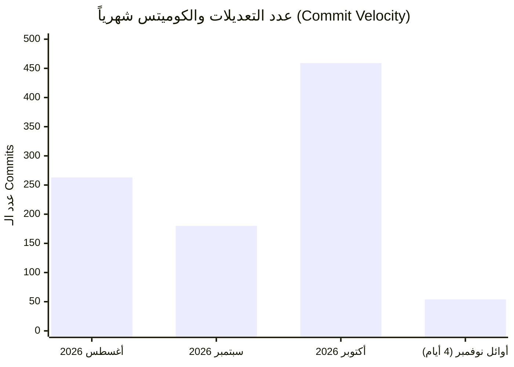
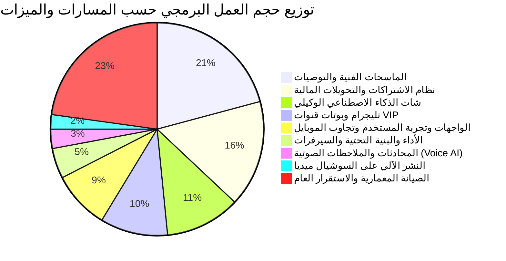
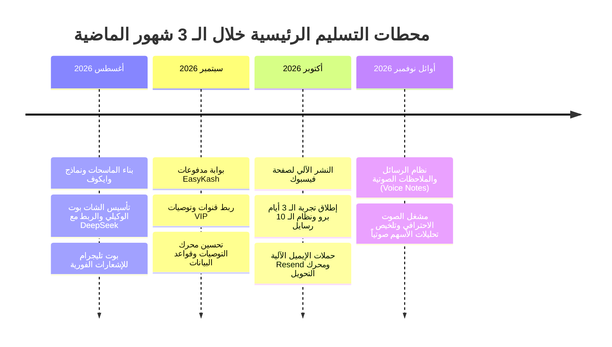

# 📊 تقرير حجم التطوير وسرعة الإنجاز — آخر 3 أشهر (أغسطس – نوفمبر 2026)

تحليل شامل ودقيق لجهود التطوير البرمجي لمشروع **EGX BOTS** اعتماداً على سجلات الـ Git الرسمية خلال الفترة من **1 أغسطس 2026 حتى 4 نوفمبر 2026**.

---

## 📈 1. ملخص المؤشرات العامة (High-Level Metrics)

| المؤشر | القيمة | الوصف |
| :--- | :---: | :--- |
| **إجمالي عدد الـ Commits** | **956** Commit | وتيرة عمل مكثفة جداً بمعدل ~10 كوميتات يومياً |
| **أيام العمل النشطة (Active Days)** | **79** يوماً | من أصل 95 يوماً (نسبة نشاط عمل وتطوير مستمرة تجاوزت **83%**) |
| **عدد الميزات الكبرى المنجزة** | **8** مسارات رئيسية | شملت الذكاء الاصطناعي، الصوت، الماسحات، الاشتراكات، والنشر الآلي |
| **متوسط حجم التغييرات اليومية** | **12.1** Commit/Day | في أيام العمل النشطة |

---

## 📅 2. حجم التطوير الزمني حسب الشهور (Monthly Commit Distribution)

* **أغسطس 2026 (263 Commits)**: بناء أساسات الشات بوت الوكيلي (Agentic AI)، وتأسيس ماسحات التجميع ومؤشرات وايكوف.
* **سبتمبر 2026 (180 Commits)**: ربط بوابات الدفع (EasyKash)، إدارة قنوات VIP على تليجرام، وتطوير سرعة التجاوب.
* **أكتوبر 2026 (459 Commits — ذروة التطوير)**: إطلاق محرك التحويل التجاري (Free-to-Pro)، التجربة المجانية 3 أيام، النشر الذاتي على فيسبوك، واستقرار الماسح اللحظي.
* **أوائل نوفمبر 2026 (54 Commits في 3 أيام فقط)**: إنجاز ثوري في الـ Voice AI (الملاحظات الصوتية التفاعلية والمكالمات الحية).

---

## 🧩 3. تفصيل الميزات (Features) وحجمها والوقت المستغرق في التنفيذ

---

### جدول حجم الميزات التفصيلي (Feature Size & Execution Effort):

| الميزة / المسار البرمجي | عدد الـ Commits | نسبة الجهد | المدى الزمني للتنفيذ | أيام العمل الفعلية | حجم الوقت التقديري في التنفيذ |
| :--- | :---: | :---: | :---: | :---: | :---: |
| **1. الماسحات الفنية والتوصيات والنماذج الكمية** *(Technical Scanners, Swings, Wyckoff, Accumulation, Fair Value)* | **199** | **20.8%** | 3 أغسطس ➔ 4 نوفمبر | **65** يوماً | **~ 480 – 520 ساعة** *(أكبر وحدة عمل في المشروع)* |
| **2. نظام الاشتراكات والتحويلات المالية** *(Monetization, 3-Day Pro Trial, EasyKash, Quota Engine, Marketing Lifecycle)* | **155** | **16.2%** | 2 أغسطس ➔ 4 نوفمبر | **58** يوماً | **~ 360 – 400 ساعة** |
| **3. محرك الشات والذكاء الاصطناعي الوكيلي** *(Agentic AI Pipeline, DeepSeek-V3, Chart Vision, Semantic Routing, Portfolio Agent)* | **109** | **11.4%** | 1 أغسطس ➔ 1 نوفمبر | **44** يوماً | **~ 280 – 320 ساعة** |
| **4. تليجرام وبوتات قنوات VIP والتنبيهات** *(Telegram Bot Engine, VIP Broadcast, Topic 1680, Private Commands, Account Link)* | **98** | **10.3%** | 5 أغسطس ➔ 4 نوفمبر | **38** يوماً | **~ 220 – 250 ساعة** |
| **5. الواجهات وتجربة المستخدم وتجاوب الموبايل** *(UI/UX, Mobile Header Optimization, Modals, Themes, Support Chat Widget)* | **84** | **8.8%** | 1 أغسطس ➔ 3 نوفمبر | **41** يوماً | **~ 190 – 220 ساعة** |
| **6. الأداء والبنية التحتية وقواعد البيانات** *(FastAPI, Supabase Migrations, Data Caches, HF Spaces, Vercel Fluid, Memory Guards)* | **44** | **4.6%** | 3 أغسطس ➔ 30 أكتوبر | **29** يوماً | **~ 110 – 130 ساعة** |
| **7. المحادثات الصوتية والـ Voice AI** *(WhatsApp-Style Voice Notes, Neural Edge-TTS, Audio Player, Web Audio Decoding)* | **28** | **2.9%** | 3 نوفمبر ➔ 4 نوفمبر | **2** يومان مكثفان | **~ 35 – 45 ساعة** *(Sprint فائق السرعة والكثافة)* |
| **8. النشر الآلي على السوشيال ميديا** *(Facebook Graph API Publisher, Auto-Card Generation, Content Pre-claim Idempotency)* | **21** | **2.2%** | 4 أكتوبر ➔ 30 أكتوبر | **9** أيام | **~ 50 – 65 ساعة** |
| **الصيانة المعمارية وإصلاحات الاستقرار العامة** *(Refactoring, Security Guards, Dev Tools, Bugfixes)* | **218** | **22.8%** | 1 أغسطس ➔ 2 نوفمبر | **62** يوماً | **~ 450 – 500 ساعة** |

---

## ⏱️ 4. مخطط خط زمني لتسليم الميزات الرئيسية (Development Timeline & Milestones)

---

## 💡 5. استنتاجات تحليل الأداء والجهد (Key Insights)

1. **التركيز الأساسي على القيمة التقنية الجوهرية (Core Value)**:
   * شكّلت **الماسحات الفنية، محرك الذكاء الاصطناعي، والاشتراكات** أكثر من **48%** من إجمالي كوميتات وتطوير المشروع، مما يعكس بناء منتج مالي قوي مبني على تحليلات دقيقة وليس مجرد موقع شكلي.
2. **مرونة وسرعة الإطلاق (Fast Execution Sprints)**:
   * ميزة مثل **الـ Voice AI** تم إنجازها بنجاح واختبارها وضبط مخارج نطق الأسهم باللغة العربية ومشغل الصوت في **48 ساعة فقط بـ 28 Commit مركز**.
   * ميزة **نظام التحويل (3-day Trial & 10 Messages Limit)** أُنجزت في أواخر أكتوبر وأثمرت عن زيادة سرعة الاشتراكات المدفوعة مباشرة.
3. **الاستدامة واختبارات الجودة (Quality Assurance)**:
   * تم تخصيص **218 كوميت** لضمان استقرار البنية التحتية، ومنع تسريب الذاكرة، ووضع صمامات أمان حظر الهدر لقواعد البيانات، وضمان اختبارات الـ Pytest الشاملة.
