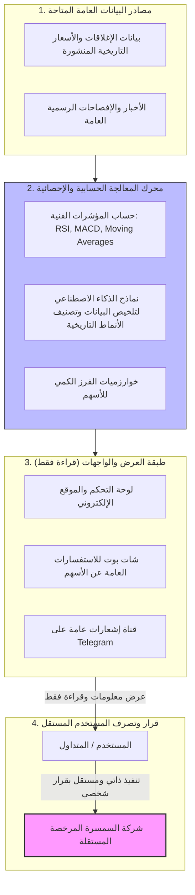

# المرفق رقم (2): مخطط سير العمليات وتدفق البيانات (System Architecture & Data Flow)

## 1. مخطط تدفق البيانات من المصدر وحتى المستخدم

---

## 2. الشرح الفني للعمليات
1. **جلب البيانات:** تقتصر البيانات التي تعتمد عليها المنصة على البيانات العامة والتاريخية وحركات التداول الرسمية المتاحة لعموم السوق.
2. **المعالجة الآلية:** تقوم الخوارزميات بإجراء عمليات حسابية ومطابقات رياضية معروفة في علوم التحليل المالي والكمي (مثل حساب متوسطات الحركة، ومؤشرات السيولة، واكتشاف الأنماط الكلاسيكية).
3. **طبقة العرض والاطلاع (Read-Only Interface):**
   * تعرض المنصة نتائج تلك العمليات الحسابية في شكل جداول، ورسوم بيانية، وتصنيفات رياضية عامة.
   * لا يوجد أي كود برمجي أو واجهة برمجية (API) قادرة على التواصل مع خوادم البورصة المصرية أو شركات الوساطة لإجراء أي عمليات شراء أو بيع.
4. **انفصال حلقة التداول عن المنصة:**
   * المنصة تنتهي وظيفتها تماماً بمجرد ظهور المؤشر الحسابي على الشاشة.
   * لا تملك المنصة أي مسار لتتبع ما إذا كان المستخدم قد قام بالشراء أو البيع، ولا تشترك في تنفيذ أي أمر، حيث يقع التنفيذ حصراً خارج المنصة بين المستخدم وشركة السمسرة المرخصة الخاضعة لإشراف الهيئة.
