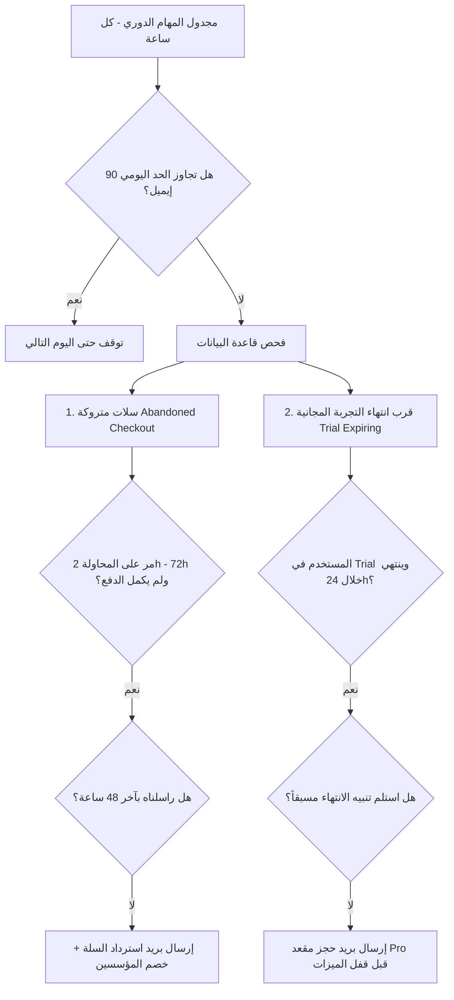

# توثيق محرك التسويق الدوري واسترداد الاشتراكات (Marketing Lifecycle Engine)

## 1. التعريف والاسم في النظام

- **الاسم التقني (Module Name):** `MarketingLifecycleEngine`
- **الملف البرمجي الرئيسي:** [`api/marketing_lifecycle.py`](file:///c:/Users/MR__CODER__/Desktop/stokscan_AI/api/marketing_lifecycle.py)
- **المُجدوِل (Scheduler Runner):** مُدمج داخل [`api/daily_job_scheduler.py`](file:///c:/Users/MR__CODER__/Desktop/stokscan_AI/api/daily_job_scheduler.py) في الدالة `run_marketing_lifecycle()`.
- **نقطة نهاية إلغاء الاشتراك (Unsubscribe API):** [`web/src/app/api/marketing/unsubscribe/route.ts`](file:///c:/Users/MR__CODER__/Desktop/stokscan_AI/web/src/app/api/marketing/unsubscribe/route.ts)
- **مزود الإرسال السحابي:** [Resend API](https://resend.com) عبر المفتاح البيئي `RESEND_API_KEY`.

---

## 2. الهدف الاستراتيجي للنظام

تحويل المستخدمين المجانيين إلى مشتركين مدفوعين (**Free-to-Pro Conversion**) عبر رسائل بريدية ذكية ومُخصصة تُرسل تلقائياً في اللحظة المناسبة بناءً على سلوك المستخدم، دون إزعاج أو احتساب رسائل غير مرغوب فيها (Spam).

---

## 3. مسارات وحملات الإرسال المؤتمتة (Automated Campaigns)



### الحملة الأولى: استرداد السلات ومحاولات الدفع المتروكة (`abandoned_checkout`)
- **المُستهدَف:** أي مستخدم فتح صفحة الدفع واختار خطة Pro ولكنه لم يكمل عملية السداد.
- **شرط التوقيت:** مر على المحاولة ساعتان على الأقل ولم يمر أكثر من 72 ساعة.
- **المحتوى الإعلاني:** 
  - تذكير لطيف بأن مقعده في عرض المؤسسين (Founders Offer) ما زال محجوزاً مؤقتاً.
  - إبراز ميزات باقة Pro (توصيات الذكاء الاصطناعي اليومية، صفقات السوينج السريعة اللحظية، وتنبيهات التليجرام VIP).
  - زر مباشر لاستكمال الدفع بضغطة واحدة.

### الحملة الثانية: تنبيه قرب انتهاء التجربة المجانية (`trial_expiring_24h`)
- **المُستهدَف:** المشتركون الذين فعّلوا فترة الـ 3 أيام المجانية Pro (`subscription_trials`).
- **شرط التوقيت:** تتبقى أقل من 24 ساعة على انتهاء التجربة، ولم يتم إرسال تنبيه مسبق لهذه التجربة.
- **المحتوى الإعلاني:**
  - تنبيه بأن التجربة تنتهي خلال ساعات، وقفل الميزات المدفوعة وشيك.
  - دعوة لتثبيت اشتراك Pro للاستمرار في استقبال صفقات السوينج ورموز الدخول والأهداف بدون انقطاع.

---

## 4. حواجز الأمان والحماية ضد السبام (Safety & Anti-Spam Guards)

1. **الحد الأقصى اليومي (Daily Send Cap):**
   - محدد بحد أقصى **90 إيميل يومياً** (`MARKETING_DAILY_EMAIL_CAP = 90`) للبقاء دائماً ضمن الباقة المجانية لمزود الخدمة (100 إيميل/يوم) وتفادي أي تكاليف إضافية.
2. **فترة التهدئة الفردية (Cooldown Guard):**
   - لا يُرسل أي بريد إعلاني لنفس المستخدم إذا تم مراسلته خلال آخر **48 ساعة**.
3. **احترام رغبة المستخدم (One-Click Unsubscribe):**
   - كل بريد يحتوي في تذييله على رابط إلغاء اشتراك مباشر ومُشفر بتوقيع أمني `HMAC-SHA256` مع معرف المستخدم والبريد الإلكتروني، لا يتطلب تسجيل دخول.
   - عند الضغط يتم تسجيل العميل فوراً في جدول `marketing_preferences` بقيمة `unsubscribed_at = NOW()` ويتوقف النظام عن إرسال أي إيميلات إعلانية له نهائياً.
4. **عزل الأخطاء (Fault Isolation):**
   - كل مستخدم يُعالج داخل كتلة `try...except` منفصلة؛ في حال فشل إرسال بريد لمستخدم معين (مثلاً بسبب خطأ في الإيميل)، يستمر النظام في معالجة باقي المستخدمين دون توقف.

---

## 5. هيكلية قاعدة البيانات (Database Schema)

### أ. جدول سجل الرسائل الإعلانية: `marketing_message_log`
| الحقل | النوع | الوصف |
| :--- | :--- | :--- |
| `id` | `uuid` | المعرف الفريد للرسالة |
| `user_id` | `uuid` | معرف المستخدم في `auth.users` |
| `campaign` | `text` | نوع الحملة (`abandoned_checkout` أو `trial_expiring_24h`) |
| `recipient_email` | `text` | البريد الإلكتروني للمستلم |
| `sent_at` | `timestamptz` | تاريخ وتوقيت الإرسال |
| `status` | `text` | حالة الإرسال (`sent` أو `failed`) |
| `metadata` | `jsonb` | بيانات إضافية (الخطة، رسالة الخطأ إن وجدت، إلخ) |

### ب. جدول تفضيلات التسويق: `marketing_preferences`
| الحقل | النوع | الوصف |
| :--- | :--- | :--- |
| `user_id` | `uuid` | معرف المستخدم (Primary Key) |
| `unsubscribed_at` | `timestamptz` | توقيت إلغاء الاشتراك (NULL تعني مشترك) |
| `reason` | `text` | سبب إلغاء الاشتراك إن وجد |

### ج. الدالة الأمنية: `get_user_email_for_marketing(p_user_id)`
دالة مُعرفة بصلاحيات `SECURITY DEFINER` في PostgreSQL للوصول الآمن لبريد المستخدم من جدول `auth.users` المقيد، وتُستخدم فقط بواسطة دور السيرفر `service_role`.

---

## 6. المتغيرات البيئية المطلوبة (Environment Variables)

| المتغير | الموقع | الوصف |
| :--- | :--- | :--- |
| `RESEND_API_KEY` | سيرفر الباك إند / Vercel / HF | مفتاح واجهة برمجة تطبيقات Resend للإرسال |
| `MARKETING_FROM_EMAIL` | سيرفر الباك إند | عنوان المرسل (الافتراضي: `onboarding@resend.dev` أو الدومين الموثق) |
| `MARKETING_DAILY_EMAIL_CAP` | سيرفر الباك إند | الحد الأقصى اليومي لعدد الرسائل (الافتراضي: `90`) |
| `NEXT_PUBLIC_APP_URL` / `APP_URL` | السيرفرين | الرابط الأساسي للمنصة لتوليد روابط الدفع وإلغاء الاشتراك |
| `SUPABASE_SERVICE_ROLE_KEY` | سيرفر الباك إند | مفتاح الوصول لقراءة الحالات وتحديث سجلات الإرسال |

---

## 7. آلية الاختبار والتشغيل اليدوي

لتشغيل فحص دورة حياة التسويق يدوياً في بيئة التطوير أو السيرفر:

```bash
# من المجلد الرئيسي للمشروع
python -c "from api.marketing_lifecycle import MarketingLifecycleEngine; engine = MarketingLifecycleEngine(); print('Engine Initialized'); res = engine.run_all(); print('Result:', res)"
```

أو عبر نقطة فحص المهام في المجدول:
```bash
python -c "from api.daily_job_scheduler import run_marketing_lifecycle; run_marketing_lifecycle()"
```

---

## 8. حملة عرض الـ 100 مؤسس وتذكير الاشتراكات (Founders & Renewals Dispatcher)

تم إنشاء أداة إرسال متخصصة للحملات الموجهة في:
- [`jobs/founders_campaign.py`](file:///c:/Users/MR__CODER__/Desktop/stokscan_AI/jobs/founders_campaign.py): لإرسال تنبيهات تليجرام المباشرة (DMs) والنشر في القناة العامة.
- [`jobs/send_founders_emails.py`](file:///c:/Users/MR__CODER__/Desktop/stokscan_AI/jobs/send_founders_emails.py): لإرسال إيميلات عرض المؤسسين (50 ج.م شهرياً مدى الحياة) وتذكير المشتركين بقرب انتهاء باقة Pro.

### أمر التشغيل:
```bash
# تجربة وهمية (Dry-run)
python jobs/send_founders_emails.py --max 35

# إرسال حي فعلي
python jobs/send_founders_emails.py --send --max 35
```

---

## 9. معايير الامتثال الرقابي للهيئة العامة للرقابة المالية (FRA Compliance)

تلتزم جميع رسائل البريد الإلكتروني وقنوات التليجرام بالضوابط القانونية والتنظيمية:
1. **حظر المصطلحات الاستثمارية الإلزامية:** منع استخدام `توصيات`، `صفقات رابحة`، أو أوامر `شراء/بيع`، واستبدالها بمصطلحات فنية استرشادية (`إشارات فنية`، `نماذج رقمية`، `أدوات مسح كمي`، `شات بوت الذكاء الاصطناعي للتحليل الفني`).
2. **صندوق التنويه القانوني الإلزامي:** يظهر في كافة رسائل تليجرام وفي الصندوق الأصفر المخصص أعلى تذييل كل إيميل مرسل:
> ⚠️ **تنبيه قانوني وإخلاء مسؤولية (FRA):** مخرجات النماذج الكمية وشات بوت الذكاء الاصطناعي هي مؤشرات وأدوات فنية وإحصائية لأغراض البحث والتحليل الفني والتعليم الشخصي فقط، ولا تمثل توصية استثمارية أو دعوة لشراء أو بيع أي ورقة مالية أو إدارة محافظ. قرارات التداول مسؤوليتك المستقلة عبر شركة سمسرة مرخصة من الهيئة العامة للرقابة المالية (FRA).

