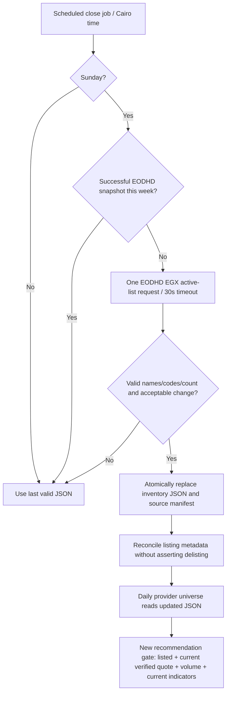

# Daily continuation, open recommendations and inventory — 12 October 2026

## Incident evidence

Job `6b9d6e00-fdfd-4967-a34c-9097f6ef02c7` recovered 236/284 price histories
at 18:41:35 Cairo, ten minutes after recovery started. All following recovery
stages were withheld despite usable coverage of 83.1%. The checker recognized
`Synced` but not `Recovered`; blocked stages consumed their one retry; the
recovery runner did not include all never-started close stages.

A bounded read of the most recent ten close runs since October 6 found 48 symbols
failing in two runs with no stored EGX price history. Provider timeouts/404s alone
do not prove exchange delisting. Nine public recommendations were open: ABUK,
APPC, CFGH, EITP, EPPK, ICFC, MFPC, QNBE, TAQA. Eight had October 12 prices;
EPPK's newest stored candle was October 11, close 9.78, volume zero.

## Changes

- Coverage reads both legacy descriptions and structured full-universe results.
  Effective audit selection still preserves full-universe coverage over a failed
  subset retry. Dependency withholding is explicitly non-execution.
- Interrupted current-session jobs enter the canonical `run_daily_job` using
  their original ID/start time and retained audit. A durable CAS checkpoint claims
  the continuation once. Successful/skipped stages, usable prices, and actual or
  ambiguous recovery/continuation attempts are not replayed. Missing/withheld
  stages execute in the original full daily order, including news, corporate
  actions, positions, notifications, similarity, archive checks, accumulation,
  cache, market outlook and social reports. Phase/date/running-state checks reject
  other jobs. Ordinary completed-job repair retains its existing bounded path.
- Two separate workers verify quotes of open recommendations while the main
  daily pipeline continues. Only missing/invalid current-session quotes receive
  one TradingView/Yahoo attempt; unresolved quotes get one EODHD session-only
  request. Durable per-job/symbol claims prevent repeated attempts. Verification
  rereads stored, valid current-session OHLCV rather than trusting provider
  success. Repaired symbols get targeted indicators and, if needed, one targeted
  late recommendation review. Missing quotes cannot advance open barriers/cursors;
  verified historical exits remain valid on their actual bars. No fake current bar
  or forced exit is created.
- New recommendations require valid current-session prices, actual trading
  volume, matching indicator date and eligible listing status. Missing histories
  and stale snapshots are excluded with audit reasons rather than a permanent
  ticker blocklist. All new database reads use bounded projections.
- History repair uses the same bounded TradingView deadline instead of calling
  unbounded `get_hist` directly.

## EODHD inventory correction

The former `_sync_latest_egx_inventory_from_eodhd` actually called a free-provider
function that loaded the existing local/database list; it never refreshed EODHD.
A single authenticated EGX exchange-symbol-list request returned HTTP 200 and
276 rows. Its active-list parameter is `delisted=0`, as described in
[EODHD's active/delisted inventory documentation](https://eodhd.com/financial-apis/delisted-stock-companies-data-2).

The previous JSON had 284 unique symbols. The returned list removes 28 and adds
20; absence from this provider list is recorded as `not_in_eodhd_inventory`, not
asserted as confirmed exchange delisting. Several failed symbols remain in the
EODHD active list and still need provider identity/coverage investigation.

`symbols_data/Egypt_all_symbols.json` now contains real EODHD names/ISINs and a
source field. `Egypt_inventory_source.json` records count, timestamp and week.
Scheduled updates run on Sunday close, reuse an already successful snapshot for
the same Sunday-based week, and retain the last valid list on HTTP/malformed/
suspiciously shrunken responses. The daily symbol reader prioritizes this JSON
over stale fundamentals. Admin inventory updates share the same validated writer.
No old inventory files or history are deleted by the new writer.

EODHD names disprove two old fundamentals aliases: AIND is Arabia Investments
Holding, distinct from ADPC/Arab Dairy; AIVCB is Al Arafa Investment And Consulting,
distinct from the old AIFI/Atlas mapping. These aliases were removed. No mechanical
ticker substitution was introduced and historical price identity was not rewritten.

## Verification and rollout

Targeted offline tests cover the exact interrupted audit, readiness, actual versus
withheld retries, the real canonical close runner through the report stage,
parallel critical repairs, stale/invalid/current zero-volume quotes, alternate
source verification, candidate exclusion, safe inventory replacement and weekly
deduplication, plus existing scheduler/recovery/recommendation/event/deadline suites.
95 targeted offline tests passed before rollout; Python compilation and diff checks
also passed. All provider/LLM/report operations in runner tests are mocked. One previously
approved EODHD inventory response was reused for the local JSON update.

The continuation deployment will automatically resume the stopped current-session
job; that is authorized production operation, not a smoke-test full replay. Actual
stage outcomes, unresolved quotes and report-provider failures must be reported
separately. No claim of full completion is valid until the persisted audit is checked.

Previous HF revision: `81d0ac7ec5c90a0509ea86edf60e1763e9e224bf`.
Rollback restores only the runtime/inventory paths changed in this task from that
revision; it cannot undo already saved prices, completed recommendation events or
reports. Do not include unrelated local short-swings cache changes in deployment.

## Actual continuation and final hardening (October 12)

Git `c4025209` / HF `5c765518883d97d58594e6b9915c57337dfcb683`
resumed the original close job at 19:26:08 Cairo, preserving its ID and 284-symbol
coverage audit. The canonical continuation reached completion at 19:47:33 Cairo:
indicators, ML, news, corporate actions, recommendations evaluation, market
refresh, accumulation, affected cache tags and the delivered daily market outlook
finished. No new BUYs were generated: the market regime gate reported panic.
236/284 price coverage remains partial; no claim that all symbols have quotes.
EPPK was repaired by one current-session EODHD response (close 9.78, volume zero),
not by an invented or forward-filled candle. Existing positions may be verified
on a zero-volume actual bar; new recommendations still require trading volume.

Follow-up changes reject TV/Yahoo histories lacking the expected EGX session even
when an earlier midday candle is cached. Failed close-refresh symbols enter the
parallel critical lane despite a cached same-date candle; unsuccessful current
source confirmation prevents evaluation from advancing on that cached candle.
Late evaluation now targets only recommendations actually blocked in the first
pass. The live old version double-counted unchanged EPPK (evaluated 10 of total
9); the regression fixture now asserts exactly one evaluation when repair already
completed before the primary pass. Trading outcomes must not be replayed to fix
an audit count.

All four social report requests were rejected before a report row was claimed.
The website readiness helper recognized only Synced, rejecting the actual
Recovered 236/284 description that Python accepts. It now mirrors the Python
full-exchange coverage/withheld audit policy. Authentication, date/phase gates,
report uniqueness and selected-evidence verification are retained. Python records
HTTP status and allowlisted rejection messages, without logging URLs/secrets.
Reports will be continued separately, only after the corrected site is live.

HF upload prevalidation silently ignored both inventory JSONs under its existing
symbols_data/*.json rule. The final runtime upload includes narrow exceptions
for exactly Egypt_all_symbols.json and Egypt_inventory_source.json, preserving
all other remote ignores. Publication must verify both remote paths and runtime
health; a successful upload response alone is insufficient.

Final offline verification: 98 Python tests and 7 Jest tests passed. The canonical
runner fixture includes the no-duplicate late review regression. Actual report
results and final deployment revisions are recorded below after verification.

HF final runtime/inventory revision: `c9a3390406894489424a183f2d544af7d8f7f022`.
All seven deployment paths, including both formerly ignored JSONs, were confirmed
at this revision. One production POST against the old site confirmed HTTP 409
with `Daily data job is not ready`, before report creation.

Next.js production build passed (including type checks). Existing prerender/cache
notices did not fail the build. HF JSON contents match local SHA-256 hashes.

Git final runtime/test commit: `47fceb07889ac83e2c7ab30f9d3b4ab2cbdfb18f`.
HF is RUNNING at `c9a3390406894489424a183f2d544af7d8f7f022` and /health is 200.
The final evaluation audit correction restores 9 evaluated of 9 / 7 closed,
using the verified initial summary: the only late review had zero updates/exits
and one unchanged result. The append-only original late review and overcount
remain visible. No recommendation operation or notification was replayed.

The Vercel MCP credential could not access the project scope; the existing CLI
credential succeeded with the same explicit team/project. Git automatic release
had not created a new deployment, so production deployment
`dpl_23ZLgZsnXYCq1SW2gZZ7XtK6EcZP` was requested from the exact tested Git SHA,
not from the working directory. Its actual readiness/alias is verified before
continuing report generation.

Vercel production `dpl_23ZLgZsnXYCq1SW2gZZ7XtK6EcZP` reached READY with
`egxbots.com` assigned and the tested full SHA `47fceb07889ac83e2c7ab30f9d3b4ab2cbdfb18f`.
The report table for October 12 was still empty before a single canonical
`resume_daily_social_reports` call. It uses the durable original-job checkpoint,
refreshes only validated daily tags, then requests the missing report kinds once.
No full daily run, trading pass, image-generation model or new notification was
invoked as a test. Report cards use the existing deterministic renderer.

### Current weekly inventory path

The snapshot published October 12 belongs to the week starting October 11.
The next normal scheduled inventory update is Sunday October 18 close. Manual
admin refresh uses the same validation/writer and is independent of this schedule.

## Report continuation and a reproduced false rejection

The single social continuation refreshed validated cache tags successfully.
Stock (KORA), accumulation and follow-up (COMI) reports became ready with ready
image cards; market failed terminally with LLM report failed verification.
Its reason attributed -13.04% to CPME as unsupported. A one-symbol October 12
indicator read confirms change_pct=-13.0435 and close=40. The offline fixture
`هبوط CPME بنسبة -13.04% في الجلسة` reproduces exactly that rejection: the gate
mapped any nominal هبوط to backtest drawdown, despite a sourced daily change.

The gate now reserves drawdown for an explicit أقصى هبوط / drawdown label and
recognizes ordinary daily decline/rise wording as daily change. Markdown and
whitespace labels normalize before metric classification. Fixtures still reject
invented -20% and borrowing a daily percentage for explicit maximum drawdown.
No numeric tolerance, attribution ownership, source verification or auth gate
was weakened. This is metric-label interpretation, not a regex intent router.

Failed verified report drafts/evidence are retained for diagnosis. An explicitly
authenticated retry_failed=true may claim a confirmed failed same-job report
once, via status + updated_at version equality. Generating/ready or already
retried reports remain duplicates; ambiguous timeouts are never replayed. The
previous failure remains in validation.previous_failure across repair results.
Tests prove the one-claim repair cannot bypass validation or consume more than
one new LLM call. The existing daily caller still never retries automatically.

51 relevant Jest tests passed, including readiness, new mover-label cases,
report failure/lease/attempt gates, chart strategies and backtest regression cases.
Only the terminally failed market report may receive one explicit repair after
this fix is deployed. The three ready reports/cards must be reused.

## Weekly inventory durability

HF rebuilds COPY the Git snapshot into ephemeral /app files. A weekly list written
only there would disappear after the next runtime deployment. The validated
inventory/manifest now also persists to the existing public market_cache row
`egx_inventory_eodhd`. A newer persisted snapshot restores the JSON atomically on
startup/daily symbol reads (bounded select payload / limit 1, deduplicated per
process for one hour), and before weekly refresh. A successful snapshot for the
same week still prevents another EODHD request after a rebuild. A durable-write
failure retains the previous files and does not claim refresh success; malformed
or older stored snapshots cannot overwrite a newer valid local list.
No per-visitor refresh/provider job or new table was introduced. The existing
manually refreshed October 12 response seeds that row once, without another
EODHD inventory call. Admin, daily universe and candidate eligibility share this
path. Offline fixtures simulate ephemeral rebuild, older data and storage failure.

## Final publication result

Runtime and web publication completed successfully:

- Git runtime/web revision: `9d2d9088c7b8e1ba2873a39eb0833d9c885554a3`.
- Vercel production: `dpl_8SV1DY7hA3qnYGRwYiXfAfjiruwz`, READY, with
  `egxbots.com` assigned to that exact revision.
- HF runtime: `ffbc888012b420716c6f6fa13e6219ff8e54a9bc`, RUNNING; `/health`
  returned HTTP 200.
- The durable `egx_inventory_eodhd` snapshot contains the verified 276-symbol
  EODHD active EGX list for the week beginning October 11. The next scheduled
  inventory refresh is Sunday October 18 close.

The one bounded social continuation initially completed stock (KORA),
accumulation and follow-up (COMI) reports with images. Market failed validation
before publishing because the gate incorrectly treated CPME's sourced -13.0435%
daily change as maximum historical drawdown. After the metric-label repair was
deployed, a single authenticated, version-guarded `retry_failed` attempt created
the market report and its image. All four October 12 reports are now `ready` with
ready images. The market report stores `recovery_attempt: 1` and the original
rejection in `previous_failure`; no report may be replayed again through this
repair path. The close job's trading, recommendation, notification and cache
stages were not run again.

Verification at completion: 101 targeted Python tests and 51 targeted Jest tests
passed; the Next.js production build passed. Build-time market-data unavailability
messages occurred while statically rendering and did not fail the build or replace
production market data.
